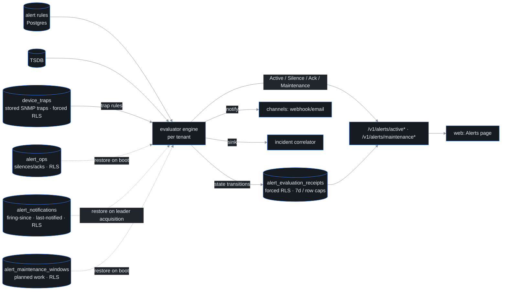

# Alerting

**What this is.** The part of probectl that watches metrics and tells a human when
something is wrong. It has two halves that together form one truth:

- **Alert rules** — durable config in Postgres. A rule is a **threshold**
  condition (value crosses a fixed line) or a **baseline** condition (value
  deviates from its own learned normal) over any metric in the TSDB (the
  time-series database), or a **trap** condition over the tenant's stored,
  authenticated SNMP traps (see [Trap rules](#trap-rules)), with **debounce** (`for_n` — the condition must hold
  for N consecutive evaluations before firing, so one noisy sample can't page
  anyone), a **renotify cadence** (how often a still-firing alert may repeat its
  notification), a severity, and delivery channels (HMAC-signed webhook — a
  webhook is an HTTP POST to a URL you choose; the HMAC is a signature computed
  over the body with a shared secret so the receiver can verify the sender — or
  email). Full CRUD at `/v1/alerts` (RBAC `alert.read` / `alert.write`).
- **Active alerts** — the engine's live truth: what is firing *right now*. The
  evaluator engine (`internal/alert`) is the single source of truth. The API and
  the web UI only *render* its state and *forward* operator actions; nothing about
  what is firing is computed client-side.
- **Maintenance windows** — reusable planned hush rules for known work. Think
  "we are patching the database every Thursday at 02:00, so matching alerts stay
  visible but do not page during that window." They are tenant-scoped, can match
  rule IDs and/or resource labels, support daily/weekly recurrence, have a
  preview API, survive control-plane restarts, and create audit events when
  changed.

The console shows read-only users disabled rule and maintenance controls, with
`alert.write` permission guidance. Silence and acknowledgement need the same
permission. Notification connector tests separately need `incident.write`;
read-only inspection and YAML export remain available.

Both rule-level channels are wired. The **webhook** channel is an HTTPS POST
with the body signed HMAC-SHA256 in `X-Probectl-Signature`. The **email**
channel delivers through the SMTP endpoint configured with
`PROBECTL_ALERT_SMTP_*` (address, envelope sender, optional auth — see
[`configuration.md`](configuration.md)); TLS is mandatory in both its modes
(`starttls`, the default, refuses a server that does not offer STARTTLS;
`implicit` speaks SMTPS from the first byte) — there is no plaintext mail
transport (§7 guardrail 12). With no SMTP address configured, a rule with an
email channel is skipped with a logged warning, and
`POST /v1/alerts/test-channel` reports the failure instead of pretending.
A webhook URL is tenant-supplied, so it must be `https://` on a public host:
a private, loopback, link-local or metadata destination is refused when the
rule is saved, and again at delivery against the address the name resolves to
(the SSRF guard). Webhook delivery honors the control plane's egress proxy
(`HTTPS_PROXY` / `NO_PROXY`). The configured proxy is the operator's own
infrastructure, so it may sit on a private or loopback address. Only the proxy
dial skips the SSRF guard; every other dial stays guarded, and what the proxy
lets through is its own egress policy. A receiver behind an enterprise CA, or a
TLS-inspecting proxy, is trusted with `PROBECTL_ALERT_WEBHOOK_CA_FILE`; an SMTP
relay behind one with `PROBECTL_ALERT_SMTP_CA_FILE`. Certificates are always
validated.
And per-rule channels are only half the notification story: incident-level
paging, chat, and ticketing connectors (PagerDuty, Opsgenie, Slack, Teams,
ServiceNow, Jira) ride the *incident* pipeline, not alert rules — see
[`docs/oncall-itsm.md`](oncall-itsm.md).

Why split it this way? Rules are operator intent and must survive restarts, so
they live in the database. "What is firing" is a live computation over the latest
samples — deriving it from the engine on every read means the UI can never drift
from reality or show a stale "firing" badge.

For incident response, the alert is only the starting signal. probectl pushes
that signal into the tenant-scoped incident timeline so the same view can show
the related BGP, flow, eBPF, device, change, and SLO evidence. The implemented
claim stops there: related signals are consolidated into one incident view.
Reducing MTTI or MTTR is a design intent, not a measured outcome; no customer or
proof-of-value receipt in this repository currently measures either one.



<a id="evaluation-loop"></a>

The evaluator ticks every `PROBECTL_ALERT_EVAL_INTERVAL` (default `30s`),
syncs the active tenant set, and keeps one evaluator engine per active tenant.
Each engine re-reads that tenant's enabled rules through the row-level-security
choke point (RLS — the database itself filters every query to one tenant's rows)
on each pass. The metric read path is tenant-scoped in both supported modes:
lightweight deployments query the in-process TSDB, while
`PROBECTL_TSDB_MODE=prometheus` deployments query the Prometheus/VictoriaMetrics
instant-query backend with a forced `tenant_id` matcher. If neither metric query
backend is wired, APIs surface `evaluator_running: false` rather than showing a
falsely empty "all clear".

When evaluation is inactive, the condition is deliberately persistent and
machine-readable: `/alerts` shows a page-level warning with setup guidance,
every `probectl alert ...` command warns on stderr, `/readyz` reports
`alerting.status=degraded` with `evaluator_running=false`, and
`/v1/diagnostics` includes a degraded `alert_evaluator` check. Readiness remains
HTTP 200 because the API can still serve and preserve rule configuration; the
explicit degraded field is the automation signal.

## Trap rules

A rule of `type: "trap"` watches the SNMP traps the tenant's device agents
authenticated and the control plane stored (`GET /v1/device/traps`, see
[`device-telemetry.md`](device-telemetry.md#snmp-traps--the-read-model))
instead of a metric. Its `trap` object says what to match:

| Field | Meaning |
|-------|---------|
| `trap_oid` (required) | The trap that fires the rule, e.g. `.1.3.6.1.6.3.1.1.5.3` (linkDown). |
| `clear_trap_oid` | Optional trap that resolves the alert, e.g. `.1.3.6.1.6.3.1.1.5.4` (linkUp). It must come from the same device and carry the same varbind. |
| `device` | Optional exact device address; empty matches every device of the tenant. |
| `varbind_oid` + `varbind_value` | Optional: the trap must carry this varbind with exactly this value, e.g. `.1.3.6.1.2.1.2.2.1.1.3` = `3` to watch ifIndex 3 only. |
| `hold_seconds` | How long a matching trap keeps the alert firing without a newer match or a clear trap: 60 to 604800, default 900. |

One alert series exists per device (labels `device`, `trap_oid`,
`trap_name`). On each pass the evaluator reads, for each device, the newest
stored trap matching either OID: a firing trap inside the hold means the series
is breaching; a newer clear trap, or a hold that ran out, means it is not, and
a firing alert resolves with that reason ("clear trap linkUp from 10.0.0.1 at
…", or "… the 15m0s hold ran out"). Everything else is the ordinary engine:
`for_n` debounce, `renotify_seconds`, silences, acknowledgements, maintenance
windows, the evaluation ledger, the incident sink and the same webhook and email
channels. A trap rule's `metric` is always `probectl_device_trap` and its
condition reads as `gte 1` on the per-device active-trap indicator, in the
webhook payload (`probectl.alert.v1`) and the evaluation receipts alike; `match`
labels, `comparison` and `threshold` are not accepted from the request.

```bash
probectl alert create --body '{"name":"uplink down","type":"trap","severity":"critical",
  "trap":{"trap_oid":".1.3.6.1.6.3.1.1.5.3","clear_trap_oid":".1.3.6.1.6.3.1.1.5.4",
          "varbind_oid":".1.3.6.1.2.1.2.2.1.1.3","varbind_value":"3","hold_seconds":900},
  "channels":[{"type":"webhook","url":"https://hooks.example/alerts","secret":"…"}]}'
```

The rule form on the Alerts page offers the same fields under **Type → SNMP
trap**. Tenancy is the evaluator's own: each tenant's engine reads that
tenant's rules and that tenant's traps through its tenant-scoped transaction
under forced row security, so one tenant's trap can never fire another
tenant's rule, even when their devices share an address. The evaluator reads a
device's newest match for 24 hours past the hold, so a fired series still
resolves after its hold. An evaluator that starts fresh (a restart, or a new
singleton leader) rehydrates the episodes its predecessor notified as firing;
on each trap rule's first pass it resolves every one of them that is no longer
firing — the trap was cleared, or the hold ran out while no evaluator was
running, including past that 24-hour read window — delivers the resolution
through the rule's channels and drops the persisted state, so no trap alert
stays firing at a receiver because the evaluator was down. Trap rules evaluate on the alert interval
(`PROBECTL_ALERT_EVAL_INTERVAL`), so a trap is noticed within one interval of
its arrival, not instantly.

## Active-alert API

| Route | Perm | Meaning |
| --- | --- | --- |
| `GET /v1/alerts/active` | `alert.read` | Every firing series for the caller's tenant, with operator state. `evaluator_running=false` distinguishes "quiet" from "not evaluating". |
| `GET /v1/alerts/{rule-id}/evaluations` | `alert.read` | Bounded deterministic state transitions for one tenant-authorized rule. Optionally pass the active alert's `evaluation_fingerprint` and `limit=1..100`. |
| `GET /v1/alerts/active/{fingerprint}/workflow` | `alert.read` | Join engine truth, immutable ack/silence receipts, an optional freshly authorized `incident_id`, and persisted connector/ticket receipts. Missing or other-tenant references fail closed. |
| `POST /v1/alerts/active/silence` | `alert.write` | `{fingerprint, duration_minutes, reason}` — suppress notifications until the deadline (`0` clears; max 7 days) and return the durable audit receipt. |
| `POST /v1/alerts/active/ack` | `alert.write` | `{fingerprint, reason}` — record the caller as owning the alert and return the durable audit receipt. |
| `GET /v1/alerts/maintenance` | `alert.read` | Reusable planned windows for the caller's tenant evaluator. |
| `POST /v1/alerts/maintenance` | `alert.write` | Create/update a window: `{name, starts_at, ends_at, recurrence, match, rule_ids}`. |
| `POST /v1/alerts/maintenance/preview` | `alert.read` | Preview matching saved or draft windows over a bounded range (`<=90d`). |
| `DELETE /v1/alerts/maintenance/{id}` | `alert.write` | Remove a reusable planned window. |

Each firing series carries an opaque `fingerprint` — the `(rule, label-set)`
identity, which is the handle for actions. Both actions are:

- **tenant-scoped** — the caller's tenant selects its own evaluator engine; an
  unknown tenant fails closed (503 / not-found, never another tenant's engine);
- **audited** — `alert.silence` / `alert.acknowledge` go to the tamper-evident
  log; and
- **durable** — the operation and audit event commit together, or the request
  fails rather than claiming a receipt that was not stored; and
- they return the engine's *updated* view plus actor, reason, start/expiry, and
  immutable audit reference, so the UI can render the write receipt immediately
  while the workflow read catches up.

## Evaluation receipts: why the alert changed state

Every active alert also carries a separate `evaluation_fingerprint`. It is the
handle for its server-authored evaluation ledger; it is deliberately separate
from the action fingerprint so silence/ack restart compatibility does not depend
on an explanation API. Fetch it with:

```sh
probectl alert evaluations <rule-id> \
  --query fingerprint='<evaluation_fingerprint>' \
  --query limit=64
```

The response records state changes only: `no_data`, baseline `warming`,
`normal`, debounce `pending`, first `firing`, renotify `steady`, and
`resolved`. Each receipt includes the observed value, the fixed threshold or
learned baseline band, current/required breach counts, baseline sample progress,
rule revision, reason, and sanitized series labels. It does **not** contain SQL,
a physical query plan, global cardinality, an ambient tenant ID, or hidden data
from another series. Think of it as the smoke detector showing the exact sensor
reading and trip line, not as a general-purpose log database.

For a current test-tag rule, `tag_selection` records the snapshot actually used
by the evaluator: `target_kind`, exact decimal-string `tag_revision`, and
`as_of`. This differs from the earlier revision saved when binding the filter.
A metadata or rule revision change produces a new receipt even if the threshold
state stays the same; an `as_of` tick alone does not duplicate a transition.
Authorized empty selections carry the same evidence on `no_data`. Missing or
invalid source evidence refuses evaluation; it cannot become an empty or healthy
result. Metric labels, series fingerprints and notification behavior stay intact.

This clock is optional on legacy receipts. Migration
`0167_alert_evaluation_tag_selection.sql` adds a bounded nullable column to the
same FORCE-RLS table without inventing historical execution proof. The existing
API, `probectl --json alert evaluations RULE_ID`, active-alert details, and the
named native `alert_evaluations` tool expose it under current active-user,
credential-scope and freshly loaded role/policy checks for `tags.read`,
`test.read` and `metrics.read`. Otherwise `tag_selection_access` is `withheld`
and every clock is removed, while established `alert.read` access to ordinary
receipts remains. `available` means current disclosure is authorized, not that
every legacy row has selection evidence. No tag values or subject/owner identity
are added to this clock. Current component proofs do not replace the complete
release-image and real-sender acceptance proof.

The ledger is intentionally small:

- at most 64 receipts per series;
- at most 256 receipts per rule;
- seven-day expiry; and
- at most 100 rows in one API read.

Migration `0065_alert_evaluation_receipts.sql` creates `tenant_id` on the table
from its first version, forces PostgreSQL RLS, and indexes tenant-first reads.
Every store statement also binds `tenant_id`, so both the database boundary and
the query text must agree. Deleting a rule deletes its receipts in the same
tenant transaction; expiry remains the bounded cleanup fallback. A receipt
write failure is logged but never stops the evaluator or notification path.
`persistence_running`, `evaluator_running`, `freshness`, and `truncated` keep
missing, stale, and partial history explicit instead of presenting a false
empty timeline.

## Semantics (the operator contract)

Silence and acknowledge are the two things an operator can do to a firing
alert, and they are deliberately different: **silence is the smoke alarm's hush
button** — the detector keeps detecting and the light stays on, it just stops
sounding for a while; **acknowledge is signing the station logbook** — it says
"this one is mine" and changes nothing about the alarm itself.

- **Silence** suppresses channel notifications *and* the incident sink for one
  series until the deadline. Mechanically, a silenced series short-circuits the
  notify path in the engine (`transition()` returns "no alert"), so neither the
  webhook/email channels nor the incident correlator fire. The series keeps
  evaluating and stays visibly firing (badged as silenced). When it resolves, the
  silence clears and the recovery notification is still sent.
- **Acknowledge** is bookkeeping: who has seen / owns it. Evaluation and delivery
  are unchanged; the ack clears on resolve.
- **Maintenance window** is a calendar hush rule: it suppresses matching firing
  notifications while the window is active, but the alert still shows in the
  active list with `silenced_until` set to the occurrence end. When the window
  expires, a still-breaching series can notify immediately because the original
  firing notification was deliberately suppressed.
- A new firing episode never inherits the previous episode's silence/ack — when a
  series resolves, the engine wipes its operator state so the next episode starts
  clean.

### Explainable grouping and reversible false-positive overrides

Incident grouping is deliberately deterministic, not magic. Signals are grouped
when their time window, target, and network-prefix facts match the versioned
`time_target_prefix_v1` rule. Each signal carries a flat, machine-readable
explanation: the grouping state, parent incident, rule, reason, window,
freshness, and match confidence. `match_confidence=1.00` means only that the
declared rule matched exactly; it is **not** a claim that probectl proved the
root cause. Missing grouping metadata is shown as unknown rather than silently
invented by the UI.

An in-tenant principal with `incident.write` can mark a selected signal as a
false grouping from the incident room. A reason is mandatory. The control plane
keeps the original signal and incident evidence, creates a new incident for the
detached signal, and writes a tenant-RLS-protected correlation override plus an
immutable audit event. Future matching signals remain excluded from the named
source incident after a control-plane restart because PostgreSQL—not process
memory—is the production source of truth. Reversal also requires a reason; it
deactivates the rule and records who reversed it, but never deletes the override
history or original evidence. Reversal affects future correlation and does not
rewrite history by silently merging the detached incident.

The provider console has no ambient mutation path for these decisions. Today,
only a tenant-authorized `incident.write` caller may create or reverse one. A
future provider-side mutation would require a separately designed,
tenant-consented, time-bounded, write-scoped break-glass path and provider audit
receipt; the existing read-only break-glass path is intentionally insufficient.

Maintenance and manual correlation decisions act at different stages. An active
maintenance window prevents a matching alert from reaching the incident sink,
so an override cannot resurrect or page on a signal that maintenance suppressed.
If a visible signal already exists, its override remains durable independently
of later maintenance-window changes.

| Route | Perm | Meaning |
| --- | --- | --- |
| `POST /v1/incidents/{id}/correlation-overrides` | `incident.write` | Detach one signal with `{signal_id, reason}`; retain all evidence and return the durable override plus new incident ID. |
| `POST /v1/incidents/{id}/correlation-overrides/{override_id}/reverse` | `incident.write` | Deactivate an active override with `{reason}`; preserve its full history. |

### Operator intent survives a restart

Firing state itself is engine-derived: it re-computes on the first evaluation
after a control-plane restart, so it is never persisted. But a **silence or ack is
operator input** that cannot be re-derived from any stream — losing it on restart
would re-page someone who had deliberately quieted an alert. So silences and acks
*are* persisted, in the `alert_ops` table (migration `0043`, tenant-RLS), as the
one sanctioned exception to "alerting state is volatile" (see
`docs/adr/volatile-stores.md`).

The mechanics are restart-safe without leaking across episodes:

- On boot, the API layer loads each tenant's persisted ops and seeds the engine
  (`Engine.RestoreOps`). A restored silence/ack is **re-applied the first time its
  fingerprint fires again** (an expired silence is skipped) — so it never
  resurrects an episode that had already ended.
- When an episode resolves, a resolve hook (`Engine.SetResolveHook`) deletes the
  persisted row, so a *future* episode of the same series starts with no inherited
  state.
- **Notification bookkeeping survives a singleton-leader failover (RTO-20).** The
  alert evaluator is a cluster singleton: one leased replica evaluates, and on
  failover a *different* replica builds fresh per-tenant engines. The per-series
  firing-since and last-notified a notification is dedup'd/renotified against used
  to live only in the old leader's memory, so a still-firing `renotify_seconds=0`
  ("notify once") alert was re-sent after the lease moved. That bookkeeping is now
  persisted per series in `alert_notifications` (migration `0115`, forced tenant
  RLS): the engine persists it on every delivery (`Engine.SetNotifyHook`), and the
  newly-elected leader rehydrates it (`Engine.RestoreNotifications`) so a
  continuously-firing alert is **not** re-notified and a `renotify_seconds>0`
  cadence resumes relative to the persisted timestamp rather than resetting to the
  moment of failover. The row is deleted by the same resolve hook, so a future
  episode notifies afresh.
- Planned maintenance is also operator intent, so it is stored in
  `alert_maintenance_windows` (migration `0058`, forced tenant RLS) and restored
  into each tenant evaluator at startup. Create/update/delete changes the engine,
  tenant row, and audit trail as one logical operation; a failed database write
  rolls the engine change back.

## The web surface

`/alerts` on the app shell: the active-alert table (state + severity filters)
sits over durable rules and maintenance windows. Its detail is one compact
alert-to-postmortem workbench: engine state, the native threshold/baseline state
timeline, bounded silence/ack actions, immutable operator receipts,
connector/ticket delivery status, and the linked incident. An opened detail
stays open when its state changes even if the table's current filter would hide
the updated row. The active list polls the engine every 15s; expired silence
returns visibly to firing. The rule form edits one delivery channel and has no
label-match field; when a rule set through the API or CLI has label matchers or
more channels, the form names them and saving keeps them unchanged. The surface uses only the shared design-system
components/tokens and remains under the WCAG 2.2 AA gate.

## Testing

`TestTrapAlertRulesAreTenantIsolated` (`-tags isolation`, real Postgres, the
production `BuildAlertEvaluator` wiring) gives two tenants the same trap rule
on devices sharing an address and proves a trap stored for one tenant never
fires the other's rule, that the tenant's own trap fires its rules, that a
clear trap and an expired hold each resolve, and nothing else; the engine and
`trapSource` unit tests pin the per-device samples, reasons and bounds.
`TestTrapEpisodeResolvesAfterEvaluatorDowntime` and
`TestTrapAlertResolvesAfterEvaluatorDownPastTheReadWindow` (real Postgres,
the evaluator down for 30 hours) prove the restart resolution, that a
still-held or debouncing series is left alone, and that metric rules are
unchanged.

`go test ./internal/alert ./internal/control` covers the engine state machine
(episode start, silence suppression including renotify windows + expiry, resolve
clearing operator state, exact evaluation-transition sequence, threshold math,
baseline warmup/bands, fail-closed errors), restart restore-and-cleanup of
silences/acks, planned-window suppression/expiry/recurrence/tenant isolation,
and the handlers (RBAC perms, tenant fail-closed workflow, evaluation, and
incident references, preview, and 404/422/503 paths). Named two-tenant
integration tests prove maintenance and evaluation rows cannot cross forced RLS;
control tests prove window audit events land in the tenant trail. `cd web && npx
vitest run` covers the surface: list + filters, deterministic evaluation
timeline, the four-interaction alert-to-postmortem journey, durable receipts,
expired silence, blocked connectors, tenant scoping (no client-side tenant
selection), evaluator-off honesty, and the axe a11y pass.

`go test ./internal/incident` additionally proves the grouping explanation,
false-positive detach, explicit reversal, evidence retention, and cross-tenant
fail-closed behavior. `TestPGIncidentCorrelationOverrideLifecycle` exercises the
same lifecycle through forced PostgreSQL RLS, restarts the correlator against the
durable store, proves a second tenant cannot observe or mutate the decision, and
checks both audit receipts. The incident-room web test covers the operator
create/reverse journey and keeps the actions behind `incident.write`.


### Current test tag filters (preview)

A threshold or baseline rule can select its current owned tests by tenant tag
criteria. This read uses current annotations over retained series: changing a
tag rule changes the next selection without relabeling the original metrics.
The API/CLI/UI/native path is preview; the complete source receipt is still
required.

Use `GET`, `PUT` or `DELETE /v1/alerts/rules/{id}/tag-filter`. The CLI equivalents are
`probectl --json alert tag-filter RULE_ID`, `alert tag-filter-set RULE_ID
--body-file criteria.json`, and `alert tag-filter-clear RULE_ID`. A set body is:

```json
{"target_kind":"test","filter":{"match":"all","conditions":[{"field":"tag.customer","op":"eq","values":["Acme"]}]}}
```

The existing nested include/exclude and regex grammar is supported for root
current test tag fields. Saved flow filters and other subject fields are
refused. Complete values retain the tag value reach; the existing 2 MiB request
and configured operation, memory, response and fairness budgets can refuse a
whole operation. Ordinary alert get/list replies expose `has_tag_filter` only;
full criteria are read separately so large values do not expand bulk rule reads.

Criteria and their configuring user reference participate in subject export
and verified erasure. Matching configuration is removed with its rule inside
the tenant's audited erasure transaction; unrelated and other-tenant rules
remain. Structural rule IDs and opaque saved-query group keys are not subject
selectors.

The authenticated active user needs current alert write and tag/test/metric read
grants to configure this selection. The evaluator reloads that user's current
roles, attributes and policy; disabling the user or revoking source read access
stops evaluation before metric reads. A scoped credential cannot borrow the
user's wider role. A live MFA assertion is usable for its request and is never
stored as background authority; source policy requiring it refuses automation.
A full rule edit preserves and reauthorizes its current filter. An explicit
clear preserves the rule's other settings and resumes its ordinary selection.

Definitions bind by immutable ID. A renamed, deleted or replaced tag requires
review rather than silently retargeting the saved selection. Unknown, unbound,
foreign or denied test references cannot match a negative criterion. Missing
owner/policy/source, stale bindings, cancellation and cost refusal produce no
unfiltered fallback or healthy evaluation. A legitimate empty authorized
selection is `no_data`, with existing alert no-data behavior. A metric's
`test_id` nominates descriptive current metadata; it is not sender attestation.
The response's revision/time describe binding of the configuration, while each
evaluation loads current metadata again.

The native MCP tools are `alert_tag_filter_get`, `alert_tag_filter_set` and
`alert_tag_filter_clear`. Get takes `rule_id`; set takes `rule_id` and the same
complete `input` object as the API. Clear takes `rule_id` and `confirmed: true`,
requires current `alert.write`, and returns no previous criteria. Get/set also
require `tags.read`, `test.read` and `metrics.read`. All three require a current
user, use the existing query admission, egress consent/redaction and call audit,
and preserve the API's current-role checks and atomic domain mutation/audit.
The native adapter's TLS/bearer/paired-tenant proof covers configuration;
release senders and complete telemetry execution remain separate requirements.

On Alerts, a metric rule's **Test tags** action opens the current criteria editor.
Load/refresh checks current source grants; nested include/exclude and regex
criteria use current root test-tag fields. Saving explicitly binds the selected
fields under the current user. Current vocabulary revision/time and the saved
binding revision are shown separately. Old criteria disappear on a refused
refresh/save or a tenant, user or permission change. The confirmed **Clear tag
filter** action remains available to a current alert writer without reading old
metadata. Trap rules do not expose this test-metric editor.

An authorized metadata GET includes an `editor` vocabulary captured in the same
RLS read snapshot as the rule/configuration: current root field names, immutable
tag IDs, text operators, shared grammar limits and its exact revision/time.
It requires no flow-source read. Mutation/clear responses omit this vocabulary;
configured whole-operation costs still refuse the complete read atomically.

The `integration` CI job runs the paired current-tag source/evaluator/RLS proof
and the real TLS/bearer/native mutation/receipt proof against a separate,
verify-full TLS Postgres database before the broad integration suite. The runner
requires both named tests to execute and pass and refuses skipped, missing,
duplicate or failed outcomes. This database is separate from the full suite's
initial state. In-process metric fixtures remain component evidence; the full
release-image, sender and four-store receipt is still required. The existing
query ownership and original regression proofs run before the broad isolation
suite; every broad suite and coverage floor remains mandatory.


## Saved Explorer query alerts (preview)

Choose **Create query alert** in Alerts, select a saved Explorer query and its
exact revision, then choose a per-group threshold or **new group** condition.
The threshold is an exact decimal string: wide counters never round through a
floating-point value. Choose a metric from the saved query in the UI; API/CLI keys must exist in
the saved plan, for example `bytes:total`. New-group mode warms the first complete selected top set without
firing; a newly selected group stays breaching while it remains in that set.
The saved query controls its time window, dimensions, top set, filters and
matrix. Summary Other buckets may satisfy a threshold but are not new identities.

Each rule uses the normal debounce, severity, delivery, acknowledgement and
incident path. Configure delivery and other rule settings through **Edit**.
The schedule is a minimum separation in seconds (default 60); the evaluator's
`PROBECTL_ALERT_EVAL_INTERVAL` tick determines actual read opportunities.
The complete plan must pass Explorer cost admission before the rule is saved.
Every scheduled read repeats admission and the active configuring user's current
source grants, bounded by the actual credential's captured read-only ceiling.
No bearer, session, attribute grant or durable MFA assertion is stored.

A revised/deleted/private source, revoked owner, incomplete coverage, timeout or
cost refusal withholds evaluation; none resolves a firing group. Explicitly
use **Bind current revision** and save the source to resume. Clearing a source also clears its opaque
baseline and disables the rule, and requires only current `alert.write`.
Reading configuration requires `alert.read`, `ai.query`, `flow.read` and current
saved-view visibility. Source-specific tags, routing and context permissions are
checked wherever the saved plan needs them. Tenant-owned rules and sources use
storage-layer tenant scope and FORCE-RLS throughout.

Create through `POST /v1/alerts` with `name` and `query_source`, replacing the
metric/type/comparison/threshold/trap fields. Inspect or rebind using
`GET|PUT|DELETE /v1/alerts/rules/{id}/query-source`. CLI operations are
`probectl alert query-source`, `query-source-set` and `query-source-clear`;
`probectl alert create --body-file rule.json` creates a rule. Native MCP exposes
`alert_query_create`, `alert_query_source_get`, `alert_query_source_set` and
`alert_query_source_clear` (the clear requires `confirmed:true`). Exact saved
revisions and threshold strings are shared across every surface.

This extension remains preview until original real-flow fire/resolve/correlation,
served both-theme accessibility, current-authority and lifecycle proofs pass.
Ordinary incident metadata contains an opaque group handle. **Inspect current
group** in alert details queries the complete saved source under the actual
reader's current permissions and shows its AS/destination dimensions and exact
value, or explicit current absence. It never advances the baseline/schedule and
is labelled a fresh query, not a historical firing receipt. Read the same data
with `GET /v1/alerts/rules/{id}/query-group?group=HANDLE`, CLI
`probectl alert query-group ID --query group=HANDLE`, or native MCP
`alert_query_group_get`. Historical source-value reconstruction remains unproven.
