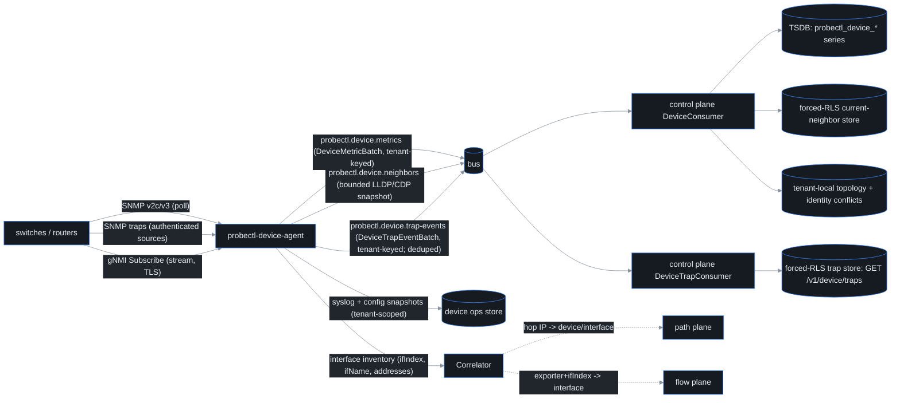

# Device / streaming telemetry — SNMP + gNMI

> With the production TSDB (`PROBECTL_TSDB_MODE=prometheus`) the device
> metrics API reads the tenant's latest samples back from the TSDB itself
> (`source: "tsdb"` in the response; `last_seen` is the query time), so
> **Planes › Device** shows the same telemetry as in memory mode (DPR-050).

## What it is

The **device plane** is probectl's "how are the switches and routers themselves
doing?" layer — the interface counters, link states, CPU, memory, and
temperatures that a tool like LibreNMS watches. A network can look healthy from
the *outside* (your synthetic probes pass) while a switch is quietly dropping
packets on one port or running hot. This plane reads that truth straight from
the gear.

One agent, `probectl-device-agent`, talks to network devices through four
operator-owned paths:

- **SNMP** (the Simple Network Management Protocol, v2c or v3) — the agent
  *polls*: every interval it asks the device a
  list of questions ("what's your uptime? how many bytes has port 7 sent?").
  The questions come from **MIBs** (Management Information Bases — the
  published catalogs of what a device can answer), and each question has an
  **OID** — its numeric address in that catalog (sysUpTime lives at
  `.1.3.6.1.2.1.1.3.0`). A configured SNMP target may separately opt in to
  bounded LLDP/CDP physical-neighbor table walks.
- **gNMI / OpenConfig** (the gRPC Network Management Interface, speaking the
  vendor-neutral OpenConfig path schema) — the agent *subscribes*: the device
  *streams* updates as
  they change, over a gRPC channel.
- **SNMP traps** — the agent *listens* for device-pushed events such as link
  up/down and cold start. Traps are off by default and accepted only from
  configured sources with a matching v2c community or authenticated v3 USM user.
  Each accepted trap is normalized into a tenant-scoped event, deduplicated by
  fingerprint against retransmits, and published once to the tenant's
  `probectl.device.trap-events` bus lane (tenant-keyed). The tenant comes from
  the agent's registered identity, never the trap payload. The control plane
  stores every accepted trap in the tenant's forced-RLS trap table, and the
  tenant reads it back through `GET /v1/device/traps`, `probectl device
  traps` and the **Traps** card on the Device page (see
  [SNMP traps — the read model](#snmp-traps--the-read-model)). Refused traps
  never get that far: the agent counts them in its payload-free `live
  ingestion record failed` log line and drops them.
- **Syslog and config archive** — authenticated control-plane APIs let an
  operator or owned collector submit device syslog lines and versioned network
  configs. Rows are tenant-bound at write/read time; configs are redacted before
  storage and versioned with a content hash so drift is explicit.

The shape difference is a nurse doing rounds versus a wearable monitor: SNMP
takes vitals on a schedule; gNMI reports the moment something changes.

Either way, both transports are normalized into a single `DeviceMetric` with the
**same metric names**, published to the bus, and landed in the time-series
database (TSDB) by the control plane — where alerts, the AI query engine, and
dashboards see them exactly like every other series.



## How it works — one model, two transports

The trick that keeps everything downstream simple: **SNMP and gNMI emit the same
metric names**, so an alert rule or dashboard never has to care which transport
fed it. (Source of truth: `internal/device/model.go`.)

| Metric | Source (SNMP) | Source (gNMI/OpenConfig) | Unit |
| --- | --- | --- | --- |
| `probectl.device.uptime.seconds` | sysUpTime | — | seconds |
| `probectl.device.if.oper.status` | IF-MIB ifOperStatus | `state/oper-status` | 1 up / 0 not |
| `probectl.device.if.speed.mbps` | ifHighSpeed | — | Mbps |
| `probectl.device.if.{in,out}.octets` | ifHC{In,Out}Octets | `state/counters/{in,out}-octets` | octets (cumulative) |
| `probectl.device.if.{in,out}.{errors,discards}` | ifTable | `state/counters/...` | packets |
| `probectl.device.if.in.{fcs,alignment}.errors` | EtherLike-MIB dot3HCStats / dot3Stats | — | packets (cumulative) |
| `probectl.device.cpu.utilization` | hrProcessorLoad (avg) | — | percent |
| `probectl.device.memory.{used,total}.bytes` | hrStorageTable (RAM row) | — | bytes |
| `probectl.device.sensor.temperature.celsius` | ENTITY-SENSOR (opt-in) | — | °C |
| `probectl.device.optical.{input,output}.power.dbm` | — | component transceiver / physical-channel / optical-channel `state/{input,output}-power/instant` | dBm |
| `probectl.device.optical.laser.bias.milliamperes` | — | transceiver physical-channel `state/laser-bias-current/instant` | mA |
| `probectl.device.optical.supply.voltage.volts` | — | transceiver `state/supply-voltage/instant` | V |

Optical collection is opt-in through the target's existing `gnmi.paths`.
For a device that exposes the OpenConfig platform/transceiver model, subscribe
to `/components/component/transceiver/state/input-power/instant`, its
`output-power` and `supply-voltage` siblings, and
`/components/component/transceiver/physical-channels/channel/state/input-power/instant`
with the corresponding output-power/laser-bias-current paths. Generic
`/components/component/state/temperature/instant` is also understood; a
temperature component is not assumed to be an optical module.

Both aggregate component readings and individual physical channels retain the
device's component key and optional channel index. Channel `0` is distinct from
an absent channel. No display-name match invents an ifIndex or canonical port.
Scalar double, integer, decimal and numeric-string readings normalize into the
existing float64 gauge store. Decimal mantissas are scaled once; a value in dBm
is not divided by 100 again. Nonfinite, unrepresentable or unsupported readings
stay absent, never a fabricated zero. Gauge values are approximations;
the separate original integer-counter lane retains exact counter words.
Only explicit OpenConfig state paths are mapped; vendor-private sensors and
SNMP watts named like optics are not silently reclassified as optical power.
Modeled device/TLS coverage does not qualify physical optical hardware.

EtherLike FCS and alignment errors prefer their original Counter64 column per
interface, with Counter32 fallback where that interface exposes no HC object.
Unsupported optional columns stay missing; a returned zero is an observation.
The same original width, poll clocks, uptime and discontinuity metadata reaches
the authenticated exact-counter history and path-interface health. Wrapped
error-counter deltas are lower bounds under continuity, never unqualified exact
rates. FCS/alignment are separate categories and are not added to IF-MIB total
errors or octet billing. The Device screen displays each category separately;
API, CLI and native path health retain the original full-width decimal words.

### Local error-rate baseline assessments (preview)

Path health also returns `error_trends` for each error/discard category. The
existing `local-zscore-v1` model compares the latest contiguous minimum rate
with earlier rates in the complete admitted health window. Three earlier rate
samples and one current sample are needed to score; fewer observations remain
explicitly untrained. No learned state is retained between reads. Duplicate
poll clocks, width changes, discontinuities and missing continuity reset
training; a stale latest poll cannot produce a current rising assessment.

Every assessment includes all contiguous original rate pairs, their counter
words/capture identities and its baseline window. Model mean, deviation and
score are approximate floating-point statistics over those minimum rates;
the original rational rates remain available. `rising_minimum_rate` does not
establish an exact true rate or a configuration-change cause. REST, generated
clients, CLI and native path health share the same current-authority reader;
the Path inspector displays the assessments and cited explanations include
their qualified evidence.

Choose **Create alert for this error counter** in a resolved path interface,
or **Create path-error alert** in Alerts. The source binds an owned path test,
one canonical interface and one original error/discard category. Each complete
current climb uses the existing durable alert episode and notification
channels. `renotify_seconds: 0` notifies once while firing, including across a
restart. Missing, stale, reset, ambiguous, untrained or unauthorized observations
hold evaluation; they never become a healthy zero. A complete current
non-breaching assessment can resolve an episode.

The source is configuration on the existing tenant-owned alert rule; the local
statistical model retains no learned state. Every evaluation intersects its
stored read-only ceiling with the owner's current user/context/source grants.
It retains no bearer or MFA assertion. A deployment requiring MFA for these
source reads currently holds unattended evaluation rather than bypassing that
policy. Source, native/served, physical sender, lifecycle and complete main CI
acceptance remain part of preview qualification.

The exact SNMP counter lane also retains optional `interface_speed_bps` from
that same poll, under its authenticated original-body receipt. Positive typed
`ifHighSpeed` (integer Mbps) takes precedence; `ifSpeed` supplies finer bps for
missing or zero high-speed values. Partial, duplicate, malformed or rounded
columns provide no speed observation. An explicitly returned zero stays distinct
from missing metadata; older agents and retained rows have unknown speed.
ClickHouse migration 9 expands the existing counter store without rewriting old
observations. Exported speed values are decimal strings. A speed snapshot does
not establish constant capacity between polls or identify a forwarding port.

These names live in the `probectl.device.*` namespace deliberately. probectl maps
its signals onto OpenTelemetry semantic conventions wherever a standard exists,
but **no OTel convention covers network-device telemetry**, so this is one of the
few places probectl owns the names. In the TSDB they become `probectl_device_*`
with labels `tenant_id, agent_id, device, device_name, source, if_index,
if_name` (`source` is `snmp` or `gnmi`). SNMP interface samples also carry
their normalized interface addresses in the tenant-keyed protobuf bus payload.
SNMP polls join the complete IP-version-neutral IP-MIB address and address-type
columns by their exact address index for IPv4 and IPv6. Unicast and anycast
remain interface addresses; entries explicitly reported as broadcast destinations
do not become owned addresses, entity aliases or topology hops. Missing, duplicate,
unmatched or invalid type metadata makes the modern address epoch unavailable;
no prefix-bit guess supplies a type. Explicitly unsupported agents retain the
legacy IPv4 table. A failed or partial
modern address walk publishes no partial address inventory or complete role-prefix
epoch. Scoped addresses preserve their device-local zone IDs in raw interface
metrics and never become unscoped canonical address aliases.
An SNMP operational-state sample requires an actual INTEGER `ifOperStatus`
value from 1 through 7. A missing, inaccessible or invalid status row produces
no status sample; it does not become zero/down. The collector also keeps the
original IF-MIB enum, so testing, unknown, dormant, not-present and lower-layer
down remain distinguishable from an explicitly reported down state. See
[IF-MIB in RFC 2863](https://www.rfc-editor.org/rfc/rfc2863.html).
Discovery review JSON omits `oper_up` when state is unavailable and retains
the exact `oper_status` and `admin_status` when reported. Offline discovery
fixtures may still supply an explicit legacy `oper_up` boolean. That stays a
binary up/not-up observation; it does not invent a more specific IF-MIB enum.
Those addresses rebuild local topology/correlation evidence during replay; they
do not become high-cardinality TSDB labels.

The sender-bound entity evidence RPC also retains bounded SNMP `sysDescr`
metadata on the configured-target address observation. A hostname-configured
target uses the connected SNMP socket's observed peer address, so an empty
`sysName` does not require an invented name or a query-time DNS lookup.
Descriptions are limited to 1,024 UTF-8 bytes. DisplayString tabs and CR/LF are
preserved; other controls and invalid text are rejected. The byte bound exceeds
the [standard sysDescr length](https://www.rfc-editor.org/rfc/rfc3418.html#section-2);
line breaks follow [DisplayString formatting](https://www.rfc-editor.org/rfc/rfc2579.html#section-2).
Malformed descriptions do not suppress the poll's other valid identity claims.
A changed description refreshes evidence immediately. The stored field is
tenant-scoped, replay-checked observational metadata; it does not identify an
entity, select a routing context or add a TSDB label. Raw evidence read surfaces
do not add this field to their existing projections.

**Planes › Device** reads the newest sample of every one of the tenant's
series back (`GET /v1/device/metrics`, also `probectl device metrics`) and
lays it out the way an operator reads a device, in its **Device telemetry**
card: one health row per device (source, uptime, CPU, memory used / total) and
one row per interface (link status, speed, octets in and out, errors and
discards in / out), with temperature sensors in their own table when the
target reports them. Component sensors retain separate aggregate/channel rows
and display optical power, laser bias, voltage and component temperature when
reported. These overview values use the TSDB's normalized numeric samples;
full-width original integer words and qualified rates are in original path
health. Alert rules and Explorer use the `probectl_device_*` series names.
The device screen requests the complete admitted latest population; neither
the old 500-series clamp nor the old 200-row table default trims this view.
Positive API/CLI `limit` values remain explicit caller maxima. Native query
memory, response bytes, execution admission and tenant query slots bound the
operation; an underfunded operation refuses the whole output. Configure
`PROBECTL_FLOW_QUERY_MAX_MEMORY_BYTES` and
`PROBECTL_FLOW_QUERY_MAX_RESPONSE_BYTES` for the complete intended workload.
The native `device_metrics` MCP tool uses the same read and admission with
current tenant-user metric/AI grants and the original credential ceiling.
Device strings retain full redaction; gauges stay numeric. Component names
and a channel index do not establish a canonical interface.

The agent also keeps a tiny in-process correlation cache so a path hop or flow
exporter can be explained as "this device/interface." That cache is not the
source of metric history; it is a derived identity read model. Stale sysName and
interface labels age out via `PROBECTL_DEVICE_CORRELATION_RETENTION` (default
`2160h`, `0` disables) so old labels stop matching after the configured window.

**Why one model matters:** a counter like "interface 7 out-octets" should look
identical whether a 15-year-old switch coughed it up over SNMP or a modern box
streamed it over gNMI — two thermometers, one chart column. Unifying at the
*metric* layer means the rest of the
platform — alerting, AI, correlation — is written once.

### Graceful degradation over MIB variance

Not every device exposes every table. A cheap access switch may have no
HOST-RESOURCES MIB (so no CPU/memory), or no sensor table. probectl handles this
with **independent, best-effort table walks**: each walk fails on its own, so a
device that lacks HOST-RESOURCES simply yields no CPU/memory samples — the rest
still flow. Think of a survey whose sections are each optional: a skipped
section yields blanks, not a voided form — only an unreachable respondent
voids it. Only an unreachable or mis-authenticated device (the system group
itself fails) fails the whole poll. You get partial truth instead of an all-or-
nothing error.

## Built-in evidence-budget profiles

`collection_profile` is a tiny compiled vocabulary for choosing how much
read-only evidence the agent asks each already-configured device to provide. It
does not download a MIB catalog, load plugins, discover targets, try
credentials, or enable a new protocol. Think of it as three factory-set
flashlight brightness levels over collectors already in the binary:

| Profile | SNMP cadence and optional walks | gNMI cadence and paths |
| --- | --- | --- |
| `minimal` | 5m; base system/interface/address/CPU/memory walks; no sensors or neighbors | 2m; interface operational status |
| `standard` | 1m; base walks; no sensors or neighbors | 30s; interface counters + operational status |
| `topology-rich` | 1m; base walks + temperature sensors + bounded LLDP/CDP | 30s; interface counters + operational status |

All profiles are local, deterministic, and bounded. `topology-rich` adds
adjacency only for SNMP targets because the current gNMI collector does not own
a topology path. It does not manufacture equivalent evidence.

A target may change a profile value only under `collection_overrides`; mixing a
profile with the legacy top-level `interval`, `sensors`, `neighbors`,
`gnmi.sample_interval`, or `gnmi.paths` keys fails configuration validation.
This makes an override visible during review instead of silently winning by
parse order. SNMP interval overrides are bounded to 15s–24h. gNMI sample
overrides are bounded to 5s–1h, and profile-mode paths are limited to the two
compiled OpenConfig paths above. Existing configurations without
`collection_profile` keep their prior explicit behavior.

```yaml
collection_profile: topology-rich
devices:
  - address: 192.0.2.10
    transport: snmpv3
    credential: core-ro
    collection_overrides:
      interval: 90s
      sensors: false
      neighbors: true
```

Review the exact effective plan before startup:

```bash
probectl-device-agent config-check -config /etc/probectl/device-agent.yaml
probectl device profiles
probectl device config-preview --config /etc/probectl/device-agent.yaml
```

The preview validates and expands the file but constructs no secret resolver,
bus, runtime, or network client. It includes target addresses, cadence, and
walk/path names, but excludes tenant identity and credential names/material.
Admin → Register collector exposes the same three profiles and returns the
selected `PROBECTL_DEVICE_PROFILE` / `collection_profile` hint. That selection
is not centrally persisted; the deployed local config remains authoritative.

## Physical adjacency — direct LLDP/CDP evidence

Metrics say how a port feels; LLDP/CDP says which port is plugged into which
neighbor. On an already-configured SNMP target, `neighbors: true` enables
read-only walks of the standard LLDP-MIB and CISCO-CDP-MIB through the same
authenticated session used for metrics. Each normalized row carries:

- tenant-bound agent and local device identity;
- local interface index and port;
- remote chassis/name, port, management address, platform, and capabilities
  when the device supplies them;
- protocol (`lldp` or `cdp`), observed time, fresh-until time, and confidence.

The row is an observation, not a guess. The control plane persists it before
acknowledging the bus message, then folds a `physical` edge into only that
tenant's topology. A remote management address is used as the remote node when
present; otherwise the protocol/chassis identity remains distinct. There is no
automatic identity merge and no invented IP.

Bounds keep one noisy device from becoming the product: 256 neighbors per
device snapshot, 16,384 retained rows per tenant, 500 rows per API read, and a
24-hour stale-evidence window. Each new source snapshot replaces the prior
current rows for that agent/device. Unsupported MIBs are an honest empty
snapshot, not an error and not synthetic topology.

Operators see the same evidence in **Planes → Device**, as `physical` edges and
coverage on **Topology**, through `GET /v1/device/neighbors`, or with
`probectl device neighbors`. Every surface distinguishes current, stale,
future/unknown, unavailable, empty, and truncated states.

Every neighbor-enabled target also emits a separate, versioned collection
receipt after each authoritative LLDP and CDP attempt on
`probectl.device.collection-outcomes`. The receipt is deliberately separate
from `probectl.device.neighbors`: a failed walk therefore cannot replace
last-known-good adjacency with an apparently healthy empty snapshot. Its stable
states are `ok_with_rows`, `healthy_empty`, `unsupported`, `failed`, and
`never_observed`; stable reason and next-action codes explain which one applies.
Only the configured target, agent, protocol, attempt/success times, row count,
and allowlisted codes are carried. Credentials, raw varbinds, discovered
neighbors, and free-form errors are excluded.

The forced-RLS current-receipt store keeps at most 4,096 target/protocol rows
per tenant for 30 days, and reads return at most 500. Operators see the same
tenant-audited contract in **Planes → Device**, **Admin → Device collection
readiness**, `GET /v1/device/collection-outcomes`, generated SDKs, and
`probectl device outcomes`. The support bundle includes the same states using
bundle-local `agent-NNNN` and `target-NNNN` references, never raw identifiers.

This is intentionally narrow. It does not scan a subnet, probe discovered
addresses, open a CLI/SSH session, fetch from a vendor service, mutate a device,
or infer bridge FDB, ARP/ND, or STP relationships. Those later evidence types
would require a separately reviewed scope.

## Correlation — tying device interfaces to the other planes

A device interface is the join point between planes — the way a flight number
joins the departure board, the baggage belt, and the crew roster. Each SNMP
poll also builds
an **interface inventory**: for every interface, its `ifIndex` (the interface's
numeric slot on the device — the same number flow exports use), its `ifName`
(falling
back to `ifDescr`), and the IP addresses from `ipAddrTable`. The
`device.Correlator` then joins the other planes on it:

- **path hop → interface**: a traceroute responder IP matches an interface
  address (or the device's management address gives a device-level match) — so a
  slow hop in a path test becomes "this hop is `core-sw1`".
- **flow → interface**: a flow record's `(exporter address, ifIndex)` pair
  matches the exporting device's named interface — turning the opaque
  "ifIndex 7" in a flow export into "`core-sw1` eth7".

This is what lets a cross-plane incident say *"the path test slowed at the same
interface where the flow plane sees a traffic spike and the device plane sees
rising discards"* — one interface, three views.

### When identity sources disagree

SNMP and gNMI do not always agree. A replacement device may reuse an address, an
interface may be renamed, or two inventories may claim the same interface
address. A normal graph-label upsert would keep only the newest string, making
the disagreement invisible. probectl therefore records the bounded normalized
claim **before** updating the display label.

The local identity index detects five conflict shapes:

- one device name claimed by competing management addresses;
- one management address claimed with competing device names;
- one interface address claimed by competing devices;
- one `(device address, ifIndex)` claimed with competing interface names;
- one `(device address, interface name)` claimed with competing indexes.

`GET /v1/device/identity-conflicts` exposes those records with the source,
tenant-bound agent, first/last observation time, age, evidence basis, competing
values, and the path/flow/topology correlations that could be wrong. The read is
bounded to 200 response rows; the tenant-local store is capped at 1,024 identity
keys, eight provenance claims per key, 64 interface addresses per observation,
and 512 Unicode characters per normalized identity field. Truncation is
explicit. Future-clock evidence is `unknown`, old disagreement is `stale`, and
two fresh distinct sources are an `active` high-confidence conflict.

The same native review card appears under **Planes → Device** and **Topology**,
and the CLI path is `probectl device conflicts`. It is intentionally
observe-only: the proposal says what a human should verify, while
`merge_supported:false` guarantees the API has no merge/remediation operation.
Correct the authoritative producer or inventory outside probectl, then let
retention remove the losing claim. No external identity service, geolocation,
or outbound lookup participates.

## Discovery and import review

The device agent can also run a **review-only discovery job**:

```bash
./bin/probectl-device-agent discover -job discovery.json -out review.json
```

Discovery is intentionally shaped like a flashlight, not a bulldozer. A job must
name one tenant, one or more **safe IPv4 ranges**, and one or more tenant-owned
credential references. Safe means private RFC1918, loopback, or link-local; a
public range such as `8.8.8.0/24` is rejected before any probe runs. Jobs also
have a `max_hosts` ceiling (default `1024`) so a typo cannot become a broad
scan.

Example job:

```json
{
  "id": "edge-rack-01",
  "tenant_id": "t-acme",
  "created_by": "netops@example.com",
  "ranges": ["10.10.40.0/28"],
  "max_hosts": 14,
  "credentials": [
    {"tenant_id": "t-acme", "name": "core-ro", "transport": "snmpv2c"}
  ],
  "classifier_rules": [
    {"role": "edge-router", "sys_name_contains": ["edge"], "confidence": 0.9},
    {"role": "access-switch", "sys_descr_contains": ["switch"], "min_interfaces": 8}
  ]
}
```

Credential entries are names only. The same `PROBECTL_DEVICE_CRED_<NAME>_*`
environment or secret-reference resolver used by normal polling resolves the
material at probe time. If a credential name is wrong or belongs to a different
tenant than the job, discovery fails closed.

Each answering device is classified from SNMP evidence: `sysName`, `sysDescr`,
and interface names/descriptions. Operator classifier rules run first; built-in
fallbacks label obvious routers, switches, and firewalls conservatively. The
output is a **review JSON** with `status: "review_required"` and each device in
`activation_state: "pending_review"`. In other words, discovery can suggest
targets, but it cannot activate monitoring by itself. An explicit review step
turns accepted candidates into ordinary device-agent `devices:` targets, and the
result carries audit events for job start, device discovery, review required,
and per-device approval.

For demos and tests, `-fixture fixture.json` drives the same workflow without
touching the network:

```json
{
  "devices": [
    {
      "address": "10.10.40.2",
      "sys_name": "edge-r1",
      "sys_descr": "router os",
      "interfaces": [
        {"index": 1, "name": "wan0", "oper_up": true, "addrs": ["10.10.40.2"]}
      ]
    }
  ]
}
```

## Credentials — referenced by name, never stored

Device credentials (SNMP communities, SNMPv3 passphrases, gNMI passwords) are
secrets, and probectl treats them like the guardrails demand: **config files
reference a credential by *name* only** — the secret material itself is resolved
at runtime through `device.CredentialSource` and is **never written to config or
git, and never logged** (the `Credential` type's `String()`/`GoString()` render
as `credential(redacted)`). Think coat check: the config holds only the
ticket; the cloakroom — the environment today, a secrets backend later — holds
the coat.

The default source reads the environment. For a credential named `core-ro`
(uppercased, with `-`/`.` mapped to `_`):

```text
PROBECTL_DEVICE_CRED_<NAME>_COMMUNITY      # SNMP v2c
PROBECTL_DEVICE_CRED_<NAME>_USERNAME       # SNMP v3 / gNMI metadata auth
PROBECTL_DEVICE_CRED_<NAME>_AUTH_PROTO     # sha (default) | sha256 | sha512 | md5
PROBECTL_DEVICE_CRED_<NAME>_AUTH_PASS
PROBECTL_DEVICE_CRED_<NAME>_PRIV_PROTO     # aes (default) | aes256 | des
PROBECTL_DEVICE_CRED_<NAME>_PRIV_PASS
  PROBECTL_DEVICE_CRED_<NAME>_PASSWORD       # gNMI metadata auth
```

A credential name that resolves to *nothing* **fails closed at startup** — a
typo can't silently downgrade you to an unauthenticated poll; the agent refuses
to start instead. The named-credential seam is also the integration point for a
real secrets backend (Vault, CyberArk, a cloud KMS) plugging in later without
touching any device config.

## SNMP traps — the read model

An accepted trap travels agent → the tenant's `trap-events` lane → the control
plane's `DeviceTrapConsumer` → the `device_traps` table → the API, the CLI and
the Device page. Each hop keeps the tenant boundary:

- **The tenant is the lane's, never the payload's.** On a tenant-namespaced
  lane (every tenant has one, hybrid and siloed tenants included) the lane
  names the tenant and overwrites whatever the record claims; the claimed agent
  must still be registered in that tenant. On the shared pooled lane the
  claimed (tenant, agent) pair must be registered, and strict-lane mode
  (`PROBECTL_INGEST_STRICT_TENANT_LANES`) refuses the shared lane outright.
  A batch with no identity, mixed identities or an unregistered pair is
  dropped and counted, never stored.
- **Untrusted input is bounded before storage.** At most 64 events per bus
  record and 64 varbinds per trap (the first 64 are kept and the record is
  marked `varbinds_truncated`), values capped at 512 bytes, OIDs dotted-decimal
  only; a binary octet string (a MAC address, an engine id) is stored as
  `0x…` hex. A device clock in the future is clamped to the receive time.
- **Idempotent on redelivery.** The agent's dedup fingerprint is unique per
  (tenant, agent), so a redelivered bus record inserts nothing. A storage
  failure is not acknowledged, so the bus redelivers it.
- **Storage is the tenant boundary.** `device_traps` (migration 0126) carries
  a non-null `tenant_id`, FORCE ROW LEVEL SECURITY and the tenant write fence
  from its first migration. Pooled and hybrid tenants' rows live in the shared
  table under row security; a siloed tenant's live in its own schema.
- **Retention.** Rows older than 30 days, and rows past the newest 10,000 per
  tenant, are pruned on write. Tenant erasure removes them all; subject
  erasure removes the rows whose sender, device address or varbind values
  match the subject. Nothing here is a configuration key.
- **No credential material, anywhere.** A record names the matched source
  (`auth_principal`: the configured source name for SNMPv2c, the USM user name
  for SNMPv3) and never the community or a passphrase.

`GET /v1/device/traps` (permission `metrics.read`) returns the caller tenant's
traps newest first, with `device` (exact address), `since`/`until` (RFC 3339,
on the receive clock) and `limit` (default 100, hard cap 500) filters:

```bash
probectl device traps --query device=10.0.0.1 --query since=2026-10-22T00:00:00Z --json
```

```json
{
  "contract_version": "probectl.device-traps/v1",
  "items": [{
    "id": "…", "agent_id": "device-agent-1",
    "device_address": "10.0.0.1", "source_address": "10.0.0.1",
    "auth_principal": "core-ro", "version": "snmpv3",
    "kind": "snmp.trap.link_down", "severity": "warning",
    "trap_oid": ".1.3.6.1.6.3.1.1.5.3", "trap_name": "linkDown",
    "if_index": 2,
    "varbinds": [{"oid": ".1.3.6.1.2.1.2.2.1.1.2", "type": "Integer", "value": "2"}],
    "observed_at": "2026-10-22T12:00:00Z", "received_at": "2026-10-22T12:00:00Z"
  }],
  "collection_running": true, "effective_limit": 100, "truncated": false,
  "retention": {"max_per_tenant": 10000, "retention_days": 30, "max_varbinds": 64}
}
```

To be told when a trap arrives, create an alert rule of type `trap` (match a
trap OID, optionally a device and one varbind value, resolve on a clear trap or
after a hold time); it fires through the ordinary alert channels — see
[Trap rules](alerting.md#trap-rules).

`collection_running: false` means this deployment has no trap store wired;
the list is then empty and nothing is inferred. The Device page's **Traps**
card shows the same rows: time, device and agent, trap name and OID, the key
varbinds (the sysUpTime/snmpTrapOID header is skipped) and the SNMP version.

## Syslog and config archive

The device operations surface covers two NMS/NCM table-stakes workflows without
turning probectl into a vendor-managed collector:

- `POST /v1/device/syslog` accepts one authenticated syslog line for the caller's
  tenant. The parser extracts PRI facility/severity and common host/app fields
  when present, but preserves the original line for investigation. `GET
  /v1/device/syslog` reads only the caller tenant's rows, with optional `device`
  and bounded `limit` filters.
- `POST /v1/device/configs` archives one device config version for the caller's
  tenant. Common secret-bearing lines (`password`, `secret`, `community`,
  `token`, keys) are redacted before storage; the stored content hash and
  previous hash produce an explicit drift flag on version 2+. `GET
  /v1/device/configs` lists the tenant's config versions, newest first.

The native **Planes → Device → Config archive** can compare a changed version
with its exact archived predecessor. The action appears only when the selected
row's `previous_hash` matches the immediately preceding original version's
`content_hash` in the
already-authorized response and both redacted contents are present. The line
comparison is deterministic, dependency-free and computed in the browser over
the complete admitted snapshots. Every changed line remains available through
paging; distant unchanged context can be expanded in full. The edit search has
finite work: high churn uses a clearly labeled complete replacement, retaining
all original lines and complete replacement-operation counts. No character,
line-count or changed-row cutoff truncates the archived content. It never
contacts the device, sends content to a model
or external service, invents missing history, or offers a write/rollback action.
`probectl device configs` reaches the same tenant-scoped API and returns the
same redacted contents and hash linkage for CLI/export workflows; it does not
claim a separate unredacted or device-control path.

An optional `binding` on `POST /v1/device/configs` explicitly associates an
operator-submitted archive with `context_id`, `device_entity_id`, `agent_id`
and `source_ref`. The server verifies that exact tenant-owned device/source
assignment and records its original assignment clocks. This is an operator
assertion; it does not attest that an agent collected the configuration. Each
source incarnation has its own version stream across display-name changes;
name-only legacy rows remain separate. The Device screen displays the binding
and refuses comparison when the immediate original predecessor is missing.

Path interface health and path-bound explanations include complete admitted
archive references for the exact current source, with original IDs, hashes,
versions and clocks. They never join by a global device name or address and
never include configuration content. A missing predecessor is explicitly
unavailable. Current context grants, source assignment, original records and
the originating credential are rechecked before publishing linked evidence.
Configuration archives remain observe-only; no device write or rollback is added.

This is intentionally **customer/MSP-owned**: use a local device agent, collector
script, or automation runner to submit syslog/config rows over the authenticated
control-plane API. probectl does not offer managed-device custody and does not
bill by line, config, byte, or device volume.

A note for **FIPS deployments**: the SNMPv3 USM (User-based Security Model —
SNMPv3's built-in authentication/encryption layer) algorithms run
inside the SNMP library — they are protocol-mandated, exactly like a TLS
handshake, not a probectl crypto path. SNMPv3's older MD5 and DES options are not
FIPS-approved, so prefer SHA-2 + AES, or use gNMI over TLS.

## gNMI transport security

gNMI always dials **TLS with certificate verification** — using the system root
store, or a private CA via `ca_file`. Verification is never disabled, and
plaintext configuration is rejected before dialing (a core guardrail: every
outbound channel validates certificates). When a credential sets a
username/password, it rides gRPC metadata only over that verified channel.

Each gNMI Subscribe response is capped at 4 MiB by an explicit client
`MaxCallRecvMsgSize`, matching the agent and OTLP gRPC safety ceiling. Hostile
or buggy devices that send an over-sized frame are rejected before normalization,
and the normalization path is covered by `FuzzGNMINormalize`.

## Configuration

See [`deploying-agents.md`](deploying-agents.md) for where the device agent
sits in the producer catalog (placement, service files, the full
producer-to-first-data path), `deploy/agent/probectl-device-agent.example.yml`
for the YAML form, and [`configuration.md`](configuration.md) for every key.
Quick start against one switch:

```bash
export PROBECTL_DEVICE_TENANT=t-acme
export PROBECTL_DEVICE_TARGET=192.0.2.1 PROBECTL_DEVICE_TRANSPORT=snmpv2c
export PROBECTL_DEVICE_CREDENTIAL=core-ro
export PROBECTL_DEVICE_PROFILE=topology-rich
export PROBECTL_DEVICE_CRED_CORE_RO_COMMUNITY=public
./bin/probectl-device-agent config-check
./bin/probectl-device-agent
```

Discovery quick start against a bounded private range:

```bash
export PROBECTL_DEVICE_CRED_CORE_RO_COMMUNITY=public
./bin/probectl-device-agent discover -job discovery.json -out review.json
```

## Testing

- The poller/normalizer is table-driven against canned-PDU fakes (a healthy
  device, degraded MIBs, an unreachable device), and the gNMI client runs against
  an in-process mock target over bufconn — both in `go test ./internal/device/...`.
- LLDP/CDP parser fixtures prove port/protocol/provenance normalization and the
  256-row cap. `TestDeviceNeighborEvidenceStorageIsTenantIsolatedAndBounded`
  exercises forced RLS and cross-tenant write/read rejection against Postgres;
  control/API tests prove persistence-before-ack, physical-edge folding,
  freshness, response bounds, and foreign-tenant invisibility.
- Discovery is pinned by fixture-network tests that classify devices, keep them
  pending review, build reviewed imports, and prove a tenant cannot list another
  tenant's discovery result.
- `TestSNMPIntegration` drives the **real** SNMP client against a live target
  when `PROBECTL_TEST_SNMP_TARGET` is set; CI starts a loopback `snmpd` target
  for it, exports `PROBECTL_TEST_REQUIRE_SERVICES=1`, and fails rather than
  skips if that target is absent. Local runs can point at lab gear or another
  simulator, or skip cleanly when the target is unset.
- `TestDeviceTrapStoreIsTenantIsolated`, `TestDeviceTrapStoreIsIdempotentFilteredAndBounded`
  and `TestDeviceTrapReadIsTenantIsolatedThroughAPIAndCLI` (`-tags isolation`,
  real Postgres) prove the trap table's row security for a pooled and a hybrid
  tenant whose devices share an address, idempotent redelivery, the retention
  and count bounds, and that the API and the CLI return each tenant only its
  own traps; the `DeviceTrapConsumer` unit tests prove the lane tenant
  overrides the payload, strict-lane and unregistered-pair rejection, and the
  bounds.
- `TestDeviceTelemetryRealStack` (the F18 real-stack receipt, CI's
  integration lane) runs two tenants' **shipped** device agents against their
  own net-snmp `snmpd` containers (SNMPv3 authPriv with secret-referenced
  passphrases, and v2c, both answering at 127.0.0.1), on the YAML their
  collector registrations return. It moves each device's eth0 counter between
  polls and requires the API, the CLI and the rendered Device page to show the
  rise for that tenant only; checks LLDP neighbors and collection receipts
  under forced RLS; sends authenticated and refused traps and requires each
  tenant's own trap — and neither refused one — on its lane, through `GET
  /v1/device/traps`, `probectl device traps` and the rendered Traps card,
  and each tenant's trap alert rule to fire to that tenant's own webhook
  receiver only (B's trap first, so a rule that lost its tenant scope would
  fire A's rule before A sent anything); and byte-searches logs, responses,
  the page, the webhook bodies and every lane record for the credentials. gNMI is not part of it: it stays proven
  against the in-process mock only.
  The same journey adds an evidence-only SVID for each registered collector,
  configures its restricted mTLS channel, and creates owned source anchors and
  `sys_descr` tag rules through public APIs. Both tag projections start empty;
  A's first live poll must populate only A, then B's poll must populate B.
  API and CLI reads require exact owned identities, values and provenance.
  A real target configuration reload must change the next poll's metadata;
  manual assignment/reset and source reanchoring must preserve current
  authority, and foreign contexts and subjects remain hidden. Private evidence
  keys join the existing secret scans. In both browser themes, each tenant's
  Admin form must show its real collected tag and then clear the result when
  a foreign subject is refused. These assertions target the effective-result
  card, independently of the rule configuration also visible on the page.
  This shared dev-service fixture does not replace the authenticated TLS/SASL
  release-image proof.
- The correlation contract (hop IP ↔ interface, flow exporter+ifIndex ↔
  interface) is pinned by `TestCorrelatorHopToInterface` and
  `TestCorrelatorFlowToInterface`. `TestPollSNMPHealthyDevice`,
  `TestBusEmitterTenantTaggedBatch`, and
  `TestIdentityConflictAPIIngestsCompetingSourcesAndIsTenantScoped` prove
  interface addresses survive poll → protobuf bus → tenant-local conflict
  detection.

## Canonical entity evidence (FX-2)

The optional `evidence` config uses a second, evidence-only `/entity/` SVID on
the existing agent gRPC/mTLS listener. Mint a one-time enrollment token pinned
to the device collector's registered `agent_id`, issue that SVID with a CSR
generated and held on the collector host, and configure its certificate, key,
control-plane CA and listener address. The certificate's tenant and agent must
match the collector's config. A missing or partial evidence credential refuses
the evidence channel; no private key is sent to the server.

After a successful SNMP poll and raw metric publish, the collector sends the
configured target address, sysName, each interface's full uint32 ifIndex,
ifName and ifDescr, and interface addresses in batches of at most 64. It
keeps the target address as the configured source reference and the original
SNMP field as provenance. A uniquely mapped interface is a separate entity
under the operator-anchored device, joined by a `contains` link backed by the
original poll evidence. The same ifIndex in another tenant, VRF or device
never selects that interface.
The same interface claim retains the original optional IF-MIB operational
state (1–7) and administrative state (1–3). Each unavailable column stays
absent. A state change or loss of availability bypasses the ordinary identity
refresh; unchanged state does not add a row on every poll. These facts are
retained on the sender-authenticated evidence plane, rather than inferred
from an ordinary bus metric. A down operational state with an administratively
disabled interface does not establish an unplanned fault.
Upgrade the control plane before the device agents: the client requires a
typed state-retention acknowledgment and refuses a legacy generic identity
acknowledgment. Raw metrics continue on their existing lane when evidence is
unavailable. This adds source facts; fault-domain verdict qualification remains
separate.
An observed interface IP is kept on that interface's evidence page when its
ifIndex entity exists. Current address resolution projects the parent device
for flow, BMP and path joins, so the configured target and one of its interface
IPs cannot create a false two-entity conflict. Reanchoring a source leaves an
old ifIndex IP unresolved instead of moving it to the newly anchored device.
The collector validates each complete claim before batching it. A malformed
SNMP label or description is skipped for canonical evidence without rejecting
the valid claims from that poll or changing the raw metric outcome.
An unchanged identity snapshot is sent at most once per 12 hours after an
all-resolved RPC response; a changed interface, address or neighbor is sent
on the next poll. The server's current-evidence window lasts 24 hours from
the observation, so routine refresh precedes expiry without adding one
durable row per minute of stable polling. A transport failure retries on the
next poll. If every claim is unresolved, the same stable snapshot retries on
the next poll. A partly accepted snapshot retries after one hour, rather than
rewriting its accepted aliases every minute;
changed identity evidence still sends on the next poll.

When the same successful poll also publishes LLDP/CDP neighbor snapshots, the
collector may send each bounded neighbor claim over the same restricted mTLS
channel. The registry keeps the original protocol, local/remote port IDs,
chassis ID, remote name and management address. It makes a `physical` link
from the mapped local interface to the remote device only when current SNMP
evidence resolves that remote address (or, without an address, its sysName) to
exactly one device in the same tenant and routing context. Missing local
ifIndex, missing remote identity, duplicate addresses/names, stale source
assignments and revoked evidence leave the neighbor raw and unlinked. A
`physical` link is a historical evidence-backed sighting; its timestamp is
not a claim that the cable remains live after a source or certificate expires.

The server uses
its current operator-owned source/context and canonical anchor to decide
whether a claim can join an entity. The packet cannot choose tenant, routing
context or entity. Missing/revoked mappings and an unavailable evidence RPC
leave canonical joins unresolved; the original bus metrics continue to flow.
`entity_evidence_accepted`, `entity_evidence_unresolved` and
`entity_evidence_errors` in the agent stats, plus the corresponding
`probectl_agent_entity_evidence_*_total` counters on `/metrics`, show this
channel's outcome without putting addresses or entity IDs in metric labels.
