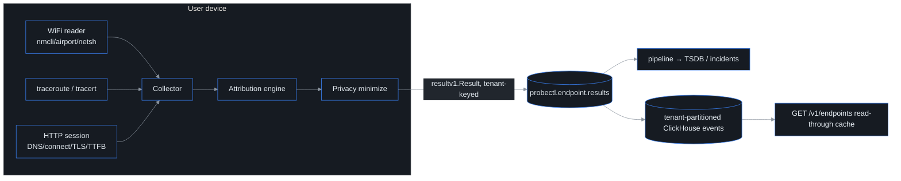

# Endpoint agent — last-mile / WiFi DEM

## What it is

> **Beta: Linux only.** The endpoint agent is supported on Linux in the beta.
> macOS and Windows builds compile but are not supported until signed builds
> and their Wi-Fi paths are proven on real hosts.

`probectl-endpoint` is a lightweight agent that runs **on a user's own device** and measures the **last mile** — the final
stretch between that device and the wider internet (its Wi-Fi link, the home
router, the ISP's access line): the part of the path that probectl's server-side
canaries physically cannot see. Your data-center probes can tell you the service
is up; they can't tell you that a particular remote employee's Wi-Fi is weak or
their home ISP is dropping packets. This agent fills that gap.

It captures four things from where the user actually sits — Wi-Fi link health,
the local gateway, the ISP / last-mile path, and browser-session timings — and
then does the part that makes it useful: it **attributes a slowdown to the
closest impaired layer**, so an operator can finally answer the hybrid-work
question, *"is it us, or the user's Wi-Fi / ISP?"*

It emits like every other probectl agent — DEM results to the operator's
**own** bus, tenant-tagged, and it **never phones home** — but it sits in a
deliberately **lower-trust tier** (threat model B9), *not* as an identity peer
of the mTLS canary agents. Unlike those, it has **no certificate or SPIFFE
identity**: the `tenant_id` it stamps is a **local assertion, never
authoritative**. The control plane re-verifies every endpoint result against the
agent registry before anything is cached or stored and refuses to consume the
lane at all without that binding (INV-08), so a device claiming another tenant
reaches no tenant's storage. This is "Digital Experience Monitoring" (DEM) done
on-device and sovereignty-respecting.



## What it measures

| Signal | Fields | Source |
| ------ | ------ | ------ |
| **WiFi** | RSSI (dBm) / signal % / noise / link rate / band / channel; cellular RSRP/RSRQ/SINR | `nmcli` or `/proc/net/wireless` (Linux), CoreWLAN (macOS), `netsh wlan` (Windows) |
| **Gateway** | reachable, RTT, loss | derived from the first (private) hop of the trace |
| **Last-mile** | per-hop RTT/loss; derived local / ISP-edge / beyond segments | `traceroute -n` (Unix), `tracert -d` (Windows) |
| **Session** | DNS / connect / TLS / TTFB / total to each target | Go `httptrace` over the hardened (cert-validating) client |

(**RSSI** is received signal strength in **dBm** — decibels relative to one
milliwatt; the values are negative and closer to zero is stronger, so −50 is
excellent and −80 is weak. **RSRP / RSRQ / SINR** are the cellular equivalents.
**RTT** is round-trip time. `traceroute` / `tracert` is the OS's own
path-mapping tool — it elicits a reply from each router along the way, hop by
hop. `httptrace` is Go's hook set that timestamps each phase — DNS, connect,
TLS, first byte — of a real HTTP request.)

Every metric is **best-effort**. A device with no Wi-Fi, or an OS that doesn't
expose a given field, degrades that field to "unavailable" rather than reporting
a false reading. A `Have.*` flag travels with each signal so the rest of the
system can tell *"we didn't measure this"* apart from *"we measured this and it
was zero"* — an important distinction when the absence of a value is itself the
diagnosis.

## Attribution — "is it Wi-Fi / ISP or the network?"

This is the headline feature. The attribution engine
(`internal/endpoint/attribution.go`, pure logic and exhaustively tested) assesses
each layer, then blames the **closest impaired layer**, walking outward from the
device:

```
wifi  →  local (gateway/LAN)  →  isp (access edge)  →  network (beyond)
```

**Why closest-first is the whole point:** a weak Wi-Fi link inflates the gateway,
ISP, *and* session numbers that are all measured *through* that link. If you
naively looked at the slow session and blamed "the network," you'd be wrong — the
real fault is the user's Wi-Fi, and the downstream numbers are just collateral.
It's checking your own tap before calling the water company: when the pressure
is low at the tap, every reading downstream of it is low too, and the nearest
fault owns the verdict. Walking outward and stopping at the first impaired layer
avoids that trap.

The verdicts (`endpoint.cause`):

- **`wifi`** — weak signal (RSSI ≤ −75 dBm, or signal ≤ 35% when only a
  percentage is available) or noise.
- **`local`** — the default gateway is unreachable, lossy, or high-RTT.
- **`isp`** — the first public hop (the ISP access edge) is high-RTT or lossy.
- **`network`** — the whole local path is healthy but a session is still slow, so
  the fault is **beyond** the last mile (the service or wider network — explicitly
  *not* the user's Wi-Fi or ISP).
- **`none`** — nothing impaired.
- **`unknown`** — a slow session, but no path visibility to localize it.

Each verdict carries a confidence (0–1) and a human-readable summary. A named
fault domain is emitted only at confidence **0.80 or higher**. Below that floor,
the result is `unknown`, while the candidate layer scores and reason remain
visible for investigation. ELI5: the engine may say “I see a clue near the
gateway,” but it does not say “the gateway did it” until the clue is strong
enough. The result also carries `endpoint.calibration_status` and
`confidence_floor`; the status is `provisional-synthetic-corpus` until a
representative design-partner corpus replaces the synthetic positive, negative,
ambiguous, and multi-cause fixtures. The synthetic gate permits no more than 1%
high-confidence misattribution, but it is not a field-accuracy claim.

The measurement cutoffs are configurable (`thresholds:` in config, defaulting
to `DefaultThresholds` — where the −75 dBm and 35% values above come from).

**Coverage is part of the verdict (DPR-061).** A "no impairment detected"
verdict is only as good as the layers it saw. When the local gateway, the
ISP edge or the session probes could not be measured — the trace never left
the LAN, `traceroute` is missing, the device is wired — the verdict lists them
(`attribution.unmeasured`, e.g. `isp, sessions`), its confidence drops to
0.5, the summary reads "no impairment detected in the measured layers;
unmeasured: …", and the sample carries the reasons (`unavailable`, e.g.
`last_mile: traceroute: exit status 2`). The agent logs a warning whenever the
set of unavailable signals changes and an info line when every layer is
measured again. The last-mile trace targets the **host** of the first
configured target (e.g. a configured `https://portal.internal` → `portal.internal`),
and a hop that never answered (`* * *`) is silence, not a 100%-loss ISP edge:
the ISP segment is the first *answering* public hop, or unmeasured.

**No probe targets ship by default** (no-phone-home, [`guardrails.md`](guardrails.md)
G7-2). Targets are operator-chosen input, never a built-in default — shipping an
external anycast host (Cloudflare/Google) would make a freshly installed agent
beacon out every interval with no operator intent, which contradicts the
sovereign / air-gap posture. An agent with no configured `targets` still measures
local Wi-Fi and gateway health; it simply runs no last-mile trace or session
probe until you point it at your own key destinations
(`targets:` in config, or `PROBECTL_ENDPOINT_TARGETS`).

## Privacy — it runs on someone's personal device

Because the agent lives on an end user's device, **data minimization is a hard
requirement, not a setting**. The principle: keep the **measurements** that
diagnose experience (signal, RTT, loss, timings — none of which identify a
person) and **gate the identifiers**.

| Field | Default | Why |
| ----- | ------- | --- |
| SSID (network name) | collected | low sensitivity (the user's own network) |
| **BSSID (AP MAC)** | **NOT collected** | geolocatable PII — public wardriving databases map BSSID → physical location (**wardriving**: the long-running hobby of logging Wi-Fi access points with GPS, published in queryable databases — an AP's MAC resolves to a street address) |
| Gateway IP (RFC1918) | collected | local, low sensitivity (RFC1918 = the private `10.x` / `172.16.x` / `192.168.x` ranges that never route on the public internet) |
| **Public last-mile hop IPs** | **NOT collected** | reveal the user's ISP and geography; the per-hop RTT/loss is kept, only the IP is dropped |

Two properties make this trustworthy:

- **Drop-on-collect.** A gated-off field is cleared *before* the sample is ever
  mapped, emitted, or logged — so it never leaves the device, not even into a log
  line. There's also a `StrictPrivacy()` preset that collects **no** identifiers
  at all, for high-governance fleets.
- **Disclosure at startup.** The agent prints **exactly what it collects** every
  time it starts (the disclosure banner) — transparency is part of running
  software on someone's machine. Tune it with `PROBECTL_ENDPOINT_COLLECT_*` (see
  [`configuration.md`](configuration.md)).

## Cross-OS collection matrix

| Capability | Linux | macOS | Windows | Fallback |
| ---------- | ----- | ----- | ------- | -------- |
| WiFi RSSI/SSID/band | `nmcli` → `/proc/net/wireless` | CoreWLAN | `netsh wlan` (signal %→dBm) | unavailable (wired) |
| Last-mile path | `traceroute -n` | `traceroute -n` | `tracert -d` | unavailable |
| Session timings | httptrace | httptrace | httptrace | (always available) |

The per-OS readers are **build-tag gated** — build tags are Go's compile-time
switches: each file carries an OS constraint and compiles only on that OS —
(`wifi_linux.go`, `wifi_darwin.go`, `wifi_windows.go`, `wifi_unsupported.go`,
`netprobe_unix.go`, `netprobe_windows.go`), each defining
`newPlatformWiFiCollector` / `newPlatformLastMileCollector` so the package
compiles on all three platforms. The macOS build needs cgo and the macOS SDK
for CoreWLAN. A macOS build without cgo keeps path and session collection
available. Linux and Windows text parsers are exercised with portable fixtures.

On macOS, CoreWLAN reads the associated link's signal, noise, transmit rate
and actual channel band. It queries SSID and BSSID only if the endpoint policy
allows each identifier. macOS also requires Location Services consent for the
calling app to see those identifiers. Signal measurements still work when the
names are unavailable. [Apple CoreWLAN](https://developer.apple.com/documentation/corewlan/cwinterface)

## Result schema → pipeline

A sample maps onto the canonical `canary.Result` envelope (`ToResults`), one
result per signal, typed `endpoint.attribution` / `.wifi` / `.gateway` /
`.lastmile` / `.session`. Numeric fields become Metrics (TSDB series);
identifiers and labels become Attributes (OTel attributes — kept out of the
time-series keyspace, so identifiers can't mint unbounded series: no cardinality
blow-up). The **attribution result is the headline**: its `endpoint.cause`
attribute *is* the Wi-Fi / ISP / network verdict.

Results are published to **`probectl.endpoint.results`** as a `resultv1.Result`,
tenant-keyed, so they flow through the **same** pipeline → TSDB / incident path as
every other canary — the control-plane result consumer drains them on its own
consumer group alongside `probectl.network.results`. A separate durable consumer
writes the event-shaped fields (SSID/gateway/session labels and attribution) to
ClickHouse. It verifies the bus lane or registered agent-to-tenant binding
*before* either cache or durable persistence, retries a bounded number of times,
and sends the original protobuf to `probectl.deadletter.results.endpoint` if ClickHouse
remains unavailable. A store failure therefore cannot silently acknowledge and
lose an endpoint event.

The console marks a no-impairment verdict with unmeasured layers as **partial
coverage**, rather than healthy. Its detail view labels those layers **Not
measured** instead of treating their zero placeholder scores as observations,
and shows the collector's unavailable-signal reason. The **No detected
impairment** filter can include these partial observations; inspect coverage
before treating a device as fully measured.

## Deploy

Managed endpoints can use the existing agent listener over mTLS. The device
holds a private enrollment identity, while Kafka or NATS credentials stay on
the control plane. First provision the tenant's one-time token through your
device management system. Run enrollment under the account that will run the
endpoint process, using a separate identity directory on each device and the
control plane's CA bundle. Supply the token on standard input.

```sh
probectl-endpoint enroll --config "$ENDPOINT_CONFIG" --ca-file "$CONTROL_CA"
```

An enrollment retry reuses the device's existing identity for the configured
tenant. If you supply `--ca-file` on retry, it must contain the trust anchors
already recorded on the device. A trust or tenant mismatch stops the command
before it reads the join token.

Set `tenant_id` and the `control.address`, `control.enrollment_url`, and
`control.identity_dir` YAML fields before enrollment. Enrollment and sampling
read these same settings. A retry keeps a valid identity for that tenant
without reading the token. `control.address` names
the agent gRPC listener, typically `control.example.test:8444`. The agent
checks enrollment, registers the device, and renews its identity through the
configured HTTPS origin. Use this mode after all control replicas support
enrolled endpoint delivery. The control plane selects the result lane and
stamps both the tenant and device IDs from the client certificate.

To prepare a native rollout, verify the installer publisher and the detached
signature on the exact delivered artifact. Put the approved installer into
this control plane's configured object store. For a pooled tenant, use
`tenant/<tenant-uuid>/endpoint-packages/<os>/<arch>/<digest-hex>` as the
object key. Siloed and hybrid tenants use `silo/<tenant-uuid>/` as the root.
Only the deployment's object-store operator needs access to the backing store.
Submit `POST /v1/rollouts` as a user with `agent.write`. Supply the fleet
version, installer `digest` (`sha256:<digest-hex>`), the `verify_method`
record, and an `endpoint` object with `platform` (such as `darwin/arm64`) and
`executable_identity` from the signed installer. The control plane checks
the staged bytes against the installer digest before saving the plan.
Review and advance each wave in the existing rollout controls.

After an operator releases a native installer to the device's rollout wave,
the management system can run this command under the enrolled account.

```sh
probectl-endpoint stage-update --config "$ENDPOINT_CONFIG" \
  --rollout "$ROLLOUT_ID" --output "$LOCAL_INSTALLER"
```

The control listener checks the current certificate registration, tenant,
rollout wave and device platform before serving the approved installer. It
rechecks the release and exact certificate registration before completing the
transfer. The endpoint waits for that success and verifies the approved
SHA-256 digest before publishing a new file. Use a new output path in a
directory controlled by the enrolled account on a local filesystem that
supports hard links, such as APFS or NTFS. A renamed or replaced output
directory causes staging to fail and the temporary file to be discarded.
Run the operating system's signature
validation and managed installer through MDM or Intune. The rollout verifies the new running code
identity on a fresh enrolled heartbeat.

### macOS managed package

The macOS package source under `deploy/packaging/macos` wraps an endpoint
binary linked to CoreWLAN in a Developer ID-signed app and installer. Build
both Mac architectures on an authorized signing host with `CGO_ENABLED=1`.
The packaging command takes an existing native binary. Use Apple’s
notarization service for the final installer, then staple and validate the
ticket before distribution.

```sh
bash deploy/packaging/macos/build-endpoint-pkg.sh \
  --binary "$MACOS_ENDPOINT_BINARY" --version "$NUMERIC_VERSION" \
  --output "$ENDPOINT_PKG" --application-identity "$DEVELOPER_ID_APPLICATION" \
  --installer-identity "$DEVELOPER_ID_INSTALLER"
xcrun notarytool submit "$ENDPOINT_PKG" --keychain-profile "$NOTARY_PROFILE" --wait
xcrun stapler staple "$ENDPOINT_PKG"
xcrun stapler validate "$ENDPOINT_PKG"
/usr/bin/shasum -a 256 "$ENDPOINT_PKG"
```

Use the SHA-256 of this final, stapled file for the tenant storage key and
rollout digest. Distribute the same file through device management.

The package installs an Aqua-session LaunchAgent. Deploy the YAML and the
device's private identity directory for the managed account. The YAML path is
`~/Library/Application Support/probectl/endpoint.yaml`. Enroll the device as
that account, then reload its launch agent or let it start at the next login.
The package contains the app and the launch definition. The app bundles
the license and third-party notices in `Contents/Resources`. The management
system supplies the YAML, CA bundle and one-time token separately. macOS
Location Services decides whether CoreWLAN can return Wi-Fi identifiers.
Measurements without those identifiers remain available. See [Apple's Mac
packaging guide](https://developer.apple.com/documentation/xcode/packaging-mac-software-for-distribution)
and [Location Services guidance](https://developer.apple.com/documentation/CoreLocation/requesting-authorization-to-use-location-services).

Install that verified package on a test Mac matching the rollout architecture
and measure the installed executable before preparing the wave.

```sh
"/Applications/probectl Endpoint.app/Contents/MacOS/probectl-endpoint" \
  version --executable-identity
```

Use the returned `cdhash:` value as the rollout's `executable_identity`.
The command measures the active Mach-O slice using the kernel's record of the
launched image and requires a kernel-reported Apple Team ID. Ad-hoc signatures
and unavailable kernel measurements produce an error. Run the check on each
target architecture when distributing a universal package.

### Windows managed MSI

Build the matching Windows `x64` or `Arm64` executable first. Build and
verify the MSI on the authorized Windows signing host using Windows Installer,
`makecab.exe` and the Windows SDK SignTool. The builder signs both the
executable and the MSI with the selected code-signing certificate.

```powershell
.\deploy\packaging\windows\Build-EndpointMsi.ps1 -Binary $EndpointBinary `
  -Version $NumericVersion -Architecture $Architecture -OutputMsi $EndpointMsi `
  -SignTool $SignTool -CertificateThumbprint $SigningCertificateThumbprint `
  -TimestampServer $TimestampServer
.\deploy\packaging\windows\Test-EndpointMsi.ps1 -Msi $EndpointMsi `
  -ExpectedVersion $NumericVersion -Architecture $Architecture `
  -CertificateThumbprint $PublisherCertificate
```

Use the signed MSI as a Windows line-of-business app in Intune. Choose the
package for the managed device's architecture. The MSI installs under Program
Files and starts the endpoint at user sign-in. The MSI installs `LICENSE.txt`
and `NOTICE.txt` beside the executable. Setup uses Windows Installer
actions for files, startup registration and upgrades. The package contains no
tenant configuration or join token. The device's `--managed` launcher reads
`%AppData%\probectl\endpoint.yaml` for the signed-in account and exits when
that file is absent. Enrollment uses the same YAML. Pass the one-time token
over stdin from your management system in the managed user's session. [Intune
Windows app deployment](https://learn.microsoft.com/en-us/intune/app-management/deployment/add-lob-windows) ·
[SignTool reference](https://learn.microsoft.com/dotnet/framework/tools/signtool-exe)

Use `probectl-endpoint version --executable-identity` to print the measured
SHA-256 of that invocation's executable, including the Authenticode
signature bytes. Windows must confirm that the open file still backs the
process's loaded image before probectl hashes it. A replaced file or an
unavailable image comparison produces an error.
The signed MSI verifier checks the package publisher, then reads the embedded
cabinet and verifies the signed executable against the same publisher and
the digest declared in the MSI. The receipt reports the package digest and
the measured executable digest as separate fields.

Set `control.identity_dir` to an absolute path on local NTFS, such as a new
`probectl\identity` directory under the managed account's local app data.
Run enrollment and the endpoint under that same account. Windows stores the
private key, certificate and trust roots in one locally protected record.
Only the running account and SYSTEM have access through its protected ACL.
Enrollment and rotation take an exclusive lock and replace the complete
record. An existing identity for another tenant is refused before another
token can be redeemed. Device management should create the configuration
directory and let enrollment create the separate identity directory.

Distribute updates in the customer's managed deployment waves using the signed
package staged for that deployment. Uninstall removes the program and its
startup registration. The per-user enrollment remains available for a repair
or reinstall. Revoke the device in the tenant registry before removing its
local enrollment when retiring a device.

### Executable evidence for managed rollouts

The control plane binds each managed endpoint process to its tenant and
agent from the enrolled mTLS certificate. Registration starts a fresh
process generation. The device measures its executable on subsequent
heartbeats, and the control plane records the time of each accepted
measurement. A restarted process clears the previous generation, and an
unavailable measurement clears the previous executable evidence.

Wave verification requires the expected executable identity from a
heartbeat received after release. An ordinary liveness heartbeat cannot
renew executable evidence. Package delivery also checks the device's
registered platform before opening the approved installer.

The current device protocol negotiates executable evidence as
`agent.endpoint_process.v1` on the existing agent listener. It carries a
bounded process generation and heartbeat sequence in authenticated RPC
metadata. Deployment placement labels are independent of this evidence.

### Direct-bus deployment

Ship the single static binary to managed devices via your **MDM** (mobile-device
management — the fleet tool that pushes software and policy to managed laptops;
Intune, Jamf). It needs **no elevated privileges**: it uses the OS's own
`traceroute` / `tracert` and read-only Wi-Fi queries. Register a tenant-bound collector identity first (see below), then point it at
Kafka or the durable lightweight NATS JetStream bus. A standalone endpoint
process cannot deliver through the in-process `memory` bus: its samples have no
consumer in that process. Use a networked bus even on a single-node deployment.
Set `PROBECTL_ENDPOINT_BUS_MODE=nats` and
`PROBECTL_ENDPOINT_BUS_BROKERS=tls://nats.internal:4222` for NATS, with the
operator's actual broker address, trusted CA and credentials through the
`PROBECTL_ENDPOINT_BUS_TLS_*` and `PROBECTL_ENDPOINT_BUS_SASL_*` settings in
[configuration.md](configuration.md). Preserve the registration response's
`agent_id`, `tenant_id` and `bus.namespace`; a tenant ID alone is not enrollment.

First deployment? The cross-producer journey — control plane, bus, and each
agent's enrollment-or-bus path — lives in
[`deploying-agents.md`](deploying-agents.md) (start at
[`getting-started.md`](getting-started.md) if nothing is running yet). You're
done when the device shows up in `GET /v1/endpoints` with an attribution
verdict — not when the process starts.

## Notes and deferrals

The shipped Linux integration runs two independent collectors against exact
HTTPS targets. The API, CLI and served console read each tenant's original
session and attribution from the durable fleet after a control-plane restart.
The test also checks that the sibling fleet stays separate and that withheld
Wi-Fi identifiers stay absent.

- **Gateway-health derivation (flagged):** gateway health is derived from the
  first hop of the last-mile trace rather than a separate privileged ping — it's
  simpler and needs no raw sockets. A dedicated low-overhead gateway probe is a
  possible future refinement.
- **Out of scope (by design):** full real-user monitoring (RUM) and deep packet
  capture. For roaming devices behind NAT (network address translation — the
  router trick that hides many devices behind one shared public address, which
  also blocks connections inbound to them), a future option is to forward
  results over the tenant-bound mTLS agent gRPC stream instead of the bus.

## The fleet surface

Endpoint results are served from a tenant-scoped **read-through snapshot**: the
per-replica cache keeps the latest result per signal type per endpoint, remains
bounded to 2,000 endpoints per tenant and 10 session targets per agent, and
evicts the stalest entries. The durable event store is ClickHouse in production
(`probectl_endpoint_events`, partitioned and ordered with `tenant_id` first) and
memory only in the lightweight profile. After a control-plane restart, the
first `GET /v1/endpoints` for tenant A loads only tenant A's latest rows into the
cache; it never scans or hydrates another tenant. The endpoint is guarded by
RBAC `agent.read` — endpoints *are* DEM agents — and
`collector_running=false` distinguishes an unwired consumer from a genuinely
empty fleet.

The web surface lives at `/endpoints`: a fleet list (attribution verdict first —
"slow: WiFi / ISP / network" — with Wi-Fi strength, gateway and ISP-edge RTT,
server-side cause/text filters, saved views, and keyboard-submit controls) and a
per-endpoint detail (Wi-Fi link, gateway / local network, last-mile segments,
browser sessions, and the per-layer attribution scores). Saved views are
tenant-owned filter sets under `GET/POST /v1/inventory/views`; they store only
the filters, not endpoint rows, so opening one always re-queries the caller's
current tenant-scoped inventory. Tenant B cannot list or open tenant A's saved
view ID.

**Privacy display contract:** identifiers the agent withheld (SSID / BSSID /
gateway IP / public hops) are absent from the results, and the UI renders that
absence **honestly** — "withheld (privacy)" — never a re-derived or fabricated
value. Numeric history lives in the TSDB series; event-shaped history lives in
ClickHouse and reconstructs the latest view after restart. The latest-view
snapshot is also an age-pruned derived cache:
`PROBECTL_DERIVED_IDENTITY_RETENTION_DAYS` removes
stale SSIDs, gateway IPs, session targets, and attribution labels from tenant
query surfaces and durable endpoint events, with `lifecycle.retention_sweep`
receipts when entries are deleted. The ClickHouse table also has the deployment
TTL configured by `PROBECTL_ENDPOINT_RETENTION_DAYS` (default 90 days; `0`
disables the table TTL).
