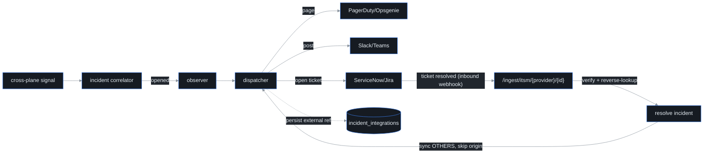

# On-call + ITSM integration

**What this is.** probectl correlates faults into incidents — but the team's
*workflow* lives in the tools they already run: PagerDuty/Opsgenie for **paging**
(waking the **on-call** engineer — whoever holds the pager this week),
Slack/Teams for chat, ServiceNow/Jira for tickets (**ITSM** — IT service
management — systems, where work is queued, assigned, and audited). This feature
mirrors a probectl incident into those tools through **connectors** — one
outbound integration per tool: it **pages on-call**, **posts to chat**, and
**opens + bidirectionally syncs tickets**.

Two boundaries to keep in mind. First, probectl stays the **system of record**
for the incident — the one authoritative copy; the connectors are a thin,
best-effort *mirror* of it, the stadium scoreboard to the referee's scorecard:
glanceable everywhere, authoritative nowhere. Second, a connector only ever
pages or posts or opens a ticket — it never auto-blocks or auto-remediates.
(Notification is confidence in the incident, not control over the network.) The
code is in `internal/notify`, wired from `internal/control/notify.go`.

**Off by default.** A connector is an *outbound* connection to the operator's
tooling, so the whole feature stays off unless `PROBECTL_NOTIFY_CONNECTORS` is set
(sovereignty / no surprise egress).

## Connectors

| Provider | Capability | On open | On resolve | Inbound (status-sync back) |
| -------- | ---------- | ------- | ---------- | -------------------------- |
| **PagerDuty** | page | Events API v2 `trigger` (dedup key `probectl-<id>`) | `resolve` (same dedup key) | resolve via the portable contract |
| **Opsgenie** | page | Alerts API create (alias `probectl-<id>`) | close-by-alias | resolve via the portable contract |
| **Slack** | chat | post "incident opened" | post "incident resolved" | — |
| **Teams** | chat | post "incident opened" | post "incident resolved" | — |
| **ServiceNow** | ticket | create incident (Table API) | set state Resolved (state `6`) | native Business-Rule POST, or the portable contract |
| **Jira** | ticket | create issue (REST v2) | transition to Done (default transition `31`) | native issue webhook, or the portable contract |
| **PSA (vendor-neutral)** | ticket | signed `create` | signed `resolve` | portable signed status contract |
| **Autotask** | ticket | create a mapped ticket through REST v1.0 | set the mapped resolved status | authenticated REST status readback or the portable signed contract |
| **HaloPSA** | ticket | create a mapped ticket through the Halo API | set the mapped resolved status | authenticated REST status readback or the portable signed contract |

Routing is **per-tenant**: a connector is registered against one tenant id and
only ever fires for incidents of that tenant.

The Alerts page links to **Docs & API → Notification routing setup** for offline
configuration prerequisites and delivery verification steps.

Operators can inspect the tenant-scoped, redacted integration posture with
`GET /v1/oncall/status` or `probectl oncall status`. The status response shows
provider counts, sanitized endpoint hosts, and inbound webhook paths for the
caller tenant only; connector secrets and endpoint path/query values are never
returned.

## Lifecycle + mapping



- **Open** — when a signal opens a *new* incident, the correlator's observer calls
  the dispatcher, which pages / posts / opens-a-ticket on each of the tenant's
  connectors and records the external reference (ticket id / page dedup key) in
  `incident_integrations`. A correlated *follow-up* signal does **not** re-page.
- **Resolve (outbound)** — resolving an incident (via the API, or an inbound
  webhook) syncs the resolution to every linked connector.
- **Resolve (inbound)** — an ITSM / on-call system posts to
  `POST /ingest/itsm/{provider}/{id}`; probectl verifies the delivery, maps the
  external ref back to the incident, resolves it, and syncs the *other* systems.

### Vendor-neutral PSA lifecycle

A PSA is the MSP's business operating system for customers, contracts, tickets,
time, and billing. The `psa` connector sends a portable
`probectl-psa-ticket/v1` JSON envelope for `create`, `update`, `resolve`, and
`reopen`. The receiving workflow maps the envelope to its PSA.

Each request has `X-Probectl-Contract: probectl-psa-ticket/v1`, a stable
`Idempotency-Key`, and `X-Probectl-Signature: sha256=<HMAC-of-exact-body>`. The
HMAC goes through `internal/crypto`. The body contains an opaque tenant-scope
digest, incident id, status, severity, times, and signal count. It does **not**
contain the raw tenant id, target, incident title, signal payload, or credential;
the ticket points to a separately authorized, signed probectl evidence export.
A create response is `{"external_ref":"PSA-12345","status":"open"}`.

Correlated signals emit idempotent `update` transitions. An explicit
`incident.write` resolve emits `resolve`; explicitly setting the incident back
to `open` emits `reopen` and is audited as `incident.reopen`. Provider-plane
operators have no implicit tenant write path; they need the existing
tenant-consented, time-bounded break-glass flow before acting as an authorized
tenant principal.

### Autotask ticket mapping

Set one `autotask` connector per tenant. Use the tenant's Autotask zone URL ending
in `/atservicesrest/v1.0` and supply the connection settings as a secret reference.
The resolver loads the JSON document at startup. Use the IDs from the tenant's
Autotask setup and a text custom field dedicated to probectl's signal count and
last observation time.

```sh
PROBECTL_NOTIFY_CONNECTORS='00000000-0000-4000-8000-000000000001|autotask|https://webservices4.autotask.net/atservicesrest/v1.0|env:AUTOTASK_CONNECTOR_JSON'
```

```json
{
  "username": "<Autotask API user>",
  "api_secret": "<Autotask API secret>",
  "integration_code": "<Autotask integration code>",
  "company_id": 101,
  "contract_id": 203,
  "queue_id": 7,
  "priority": 2,
  "open_status": 1,
  "resolved_status": 5,
  "due_after": "48h",
  "progress_field": "probectl progress",
  "console_origin": "https://observability.example"
}
```

Omit `contract_id` or `queue_id` to use the account's defaults where supported.
The API user needs permission to read and write the mapped tickets. The
connector checks the company, optional contract and incident key before every
update. The ticket links to the incident in the authenticated probectl console,
where readers with evidence access can download its signed export.

Before creating a ticket, the dispatcher reserves its link in the tenant's
incident store. A subsequent worker recovers an uncertain create by querying
the vendor for the same company and external ID. The dispatcher publishes the
link once that query finds a single matching ticket. A definite rejection
releases the reservation for a later retry.

Each reconciliation interval reads up to 50 of the tenant's open linked
tickets in one authenticated Autotask request. Pagination rotates through
the open tickets. A confirmed resolved status updates the incident and its
link together after checking that both local versions are current. The
resolution is audited and any notifications go to the other configured
connectors. [Autotask REST query fields and pagination](https://www.autotask.net/help/developerhelp/content/apis/rest/API_Calls/REST_Advanced_Query_Features.htm)

An Autotask workflow can send `{"external_ref":"12345","status":"resolved"}`
to `/ingest/itsm/autotask/<id>` using a separate tenant-bound inbound credential.
Use the numeric Autotask ticket ID as a string and sign the body using the
portable status contract. probectl matches the ticket through the tenant's
stored link and suppresses the echo back to Autotask.

[Autotask tickets and field requirements](https://autotask.net/help/developerhelp/content/apis/rest/Entities/TicketsEntity.htm)

### HaloPSA ticket mapping

Set one `halopsa` connector per tenant. Use the HTTPS origin of the Halo
instance and a secret reference that resolves to a JSON object. Create a Halo API
application with client credentials, scoped to the mapped customer and to ticket
reads and writes. A contract mapping also needs read access to that contract.

```sh
PROBECTL_NOTIFY_CONNECTORS='00000000-0000-4000-8000-000000000001|halopsa|https://tenant.halopsa.example|env:HALOPSA_CONNECTOR_JSON'
```

```json
{
  "client_id": "<Halo API application ID>",
  "client_secret": "<Halo API application secret>",
  "customer_id": 42,
  "contract_id": 17,
  "ticket_type_id": 5,
  "priority_id": 2,
  "open_status": 1,
  "resolved_status": 9,
  "progress_field_id": 123,
  "due_after": "48h",
  "console_origin": "https://probectl.example"
}
```

Use the ticket type, priority and status IDs from the Halo instance. Set
`progress_field_id` to a dedicated text field. The connector can also set
`site_id` and `user_id` when the ticket type requires them. Omit `contract_id`
to use the customer mapping alone. The optional `scope` selects OAuth
application permissions and defaults to `all` within the configured API
application permissions. [Halo client credentials](https://api.usehalo.com/reference/get_new-endpoint)

The ticket links to the authenticated incident view, where an authorized
operator can export signed evidence. probectl uses Halo's third-party ticket
ID field to recover a create after an interrupted response. It verifies the
customer, the incident's stable marker and the configured contract before a
ticket change. Periodic readback checks the resolved status of up to eight
linked tickets per reconciliation sweep. A resolution applies only while the
same local incident and link versions remain current. [Halo Swagger](https://www.usehalo.com/swagger)

For a portable signed webhook, use `/ingest/itsm/halopsa/<id>` with the
tenant's separate inbound credential and the numeric Halo ticket ID encoded
as a string.

## Idempotency

Ticket creation and paging are **idempotent** — doing it twice has the same
effect as doing it once, a doorbell rather than a counter. A `UNIQUE (tenant,
incident, connector)` link row means an incident is opened at most once per
connector, so a
delivery retry or a control-plane restart never double-pages or duplicates a
ticket — the dispatcher checks for an existing link before opening. Pager
connectors additionally pass a stable `dedup_key` / `alias` derived from the
incident id (`probectl-<id>`) — the identity the pager service itself
deduplicates on — so even a duplicate trigger that slips past the link row
coalesces server-side. Two layers, because a 3 a.m. double-page erodes exactly
the trust a pager runs on.

The per-tenant dispatcher queue is bounded and applies producer backpressure
instead of dropping a committed transition when full. Provider calls have a
deadline and retry three times; the PSA idempotency key makes an ambiguous retry
coalesce. The queue itself is process-local, but startup and periodic
reconciliation compare the current tenant-scoped incident with the durable link
revision and recover a create, update, resolve, or reopen missed by a process
crash. If the crash happened after the receiver accepted a request but before
probectl stored the link/revision, the receiver **must** honor the supplied
idempotency key so the replay coalesces. This provides durable final-state
convergence; it is not a database-transactional, exactly-once event outbox and
does not claim that every brief intermediate state is delivered.

## Bidirectional sync + loop protection

The tricky case: an on-call engineer closes the ServiceNow ticket. probectl
resolves the incident and syncs that resolution to the *other* connectors — but
**never echoes it back to its origin** (the ServiceNow ticket is already closed;
re-closing it could ping-pong forever between two systems, each politely
confirming the other's confirmation). The dispatch carries
the origin as its `source`, and the dispatcher skips that connector when fanning
out — while still marking the origin's link `resolved` so the mirror stays
accurate (`Dispatcher.Resolved(..., source)`). A duplicate inbound webhook for an
already-resolved incident is a no-op.

## Inbound contract + security

The served OpenAPI documents `POST /ingest/itsm/{provider}/{id}` with its own
signature-or-token security schemes. Session cookies and API bearer tokens do
not authenticate webhook deliveries. Sign the exact JSON bytes sent, or use the
shared token header over HTTPS. The generated SDK transport must supply that
webhook header; its normal bearer token is not a substitute.

`POST /ingest/itsm/{provider}/{id}` is an ingest surface (mounted off `/v1`, like
the change webhook). A **webhook** is an HTTP POST another system makes to you
when something happens — which means anyone who can reach the URL can attempt
one, so it authenticates **each delivery**, not a session:

- Include `X-Probectl-Signature: sha256=<hmac-of-body-under-secret>` **or**
  `X-Probectl-Token: <secret>` (constant-time compared). An **HMAC** is a keyed
  hash over the body — only a sender holding the shared secret can produce a
  valid one, and it covers the *content*, so a tampered body fails too;
  **constant-time** comparison takes the same time whether a guess is nearly
  right or completely wrong, so response timing can't leak the secret
  byte-by-byte. An unsigned, forged, or
  wrong-token delivery is rejected with `401` **before any state change** (fail
  closed). Verification routes through `internal/crypto` (`crypto.Verify` /
  `crypto.ConstantTimeEqual`).
- The delivery is **bound to the credential's tenant** (`id` → tenant), never a
  value from the payload — so one tenant can never resolve another's incident,
  even with the same external ref (RLS + a tenant-scoped reverse lookup).
- The body is treated as untrusted and is size-limited (1 MiB).

probectl understands ServiceNow (`{"sys_id","state"}`, state `6`/`7` = resolved)
and Jira (`statusCategory.key == "done"`) shapes natively; **every** provider
(including PagerDuty / Opsgenie) also supports the portable contract:

```json
{ "external_ref": "probectl-<incident-id>", "status": "resolved" }
```

A valid non-resolution status (including `acknowledged`) is an accepted no-op;
it does not acknowledge an alert or change incident state. Unknown external
references and duplicate resolutions also return `202` with `resolved:false`.


Outbound delivery uses the hardened, certificate-validating HTTP client (TLS is
never disabled). Remote provider endpoints must be `https://`. Plain `http://`
is accepted only for loopback local dev/test doubles. Treat Slack and Teams
webhook URLs as credentials when configuring the connector. Delivery failures
report a request or transport error, or the HTTP method and status for a provider
rejection. The endpoint and response body stay out of the failure logs.

## Configuration

See [`configuration.md`](configuration.md#on-call--itsm-integration) for the
key reference. Example (a tenant paging PagerDuty + ticketing Jira, with inbound
sync from Jira):

```text
PROBECTL_NOTIFY_CONNECTORS=00000000-0000-0000-0000-000000000001|pagerduty|https://events.pagerduty.com/v2/enqueue|<routing-key>,00000000-0000-0000-0000-000000000001|jira|https://acme.atlassian.net/rest/api/2/issue?project=OPS&resolve_transition=31|alice@acme.com:<api-token>
PROBECTL_NOTIFY_INBOUND=jira1:00000000-0000-0000-0000-000000000001:jira:<webhook-secret>
```

For Teams, configure `teams` with the URL of a Teams Workflows webhook using
the Anyone trigger option. The signed URL authorizes delivery of Adaptive
Cards when incidents open or resolve. Leave the separate connector secret
empty. [Microsoft Teams Workflows trigger](https://learn.microsoft.com/en-us/connectors/teams/#when-a-teams-webhook-request-is-received)

Vendor-neutral PSA example (still off unless explicitly configured):

```text
PROBECTL_NOTIFY_CONNECTORS=00000000-0000-0000-0000-000000000001|psa|https://psa-bridge.example/probectl|<hmac-secret>
PROBECTL_NOTIFY_INBOUND=psa1:00000000-0000-0000-0000-000000000001:psa:<hmac-secret>
```

## Out of scope

probectl is **not** a SIEM (see [`siem.md`](siem.md)) and **not** a CMDB; it does
not own on-call schedules or escalation policies (those stay in PagerDuty /
Opsgenie). Connectors mirror the incident outward — there is no auto-remediation
here.

The offline API explorer generates a request body from the first documented
payload alternative. Review the example and replace its reference with the
linked external incident reference before using it; webhook authentication is
still required as described above.
