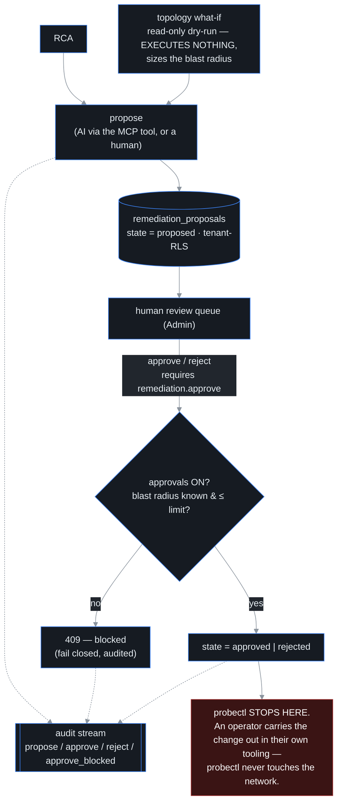

# Guarded agentic remediation (Enterprise: `remediation`)

> **The contract in one line:** probectl proposes; a human decides; nothing in
> probectl ever executes a network change. This rule has the same standing as
> the project's [Non-negotiables](../CONTRIBUTING.md#non-negotiables) and is
> enforced structurally below.

**What this is.** probectl's assistant can already do cross-plane root-cause
analysis (RCA) and simulate the impact of a topology change (the "what-if"). This
feature lets it take one more step: **propose** a remediation grounded in that
analysis — and then **stop**.

The single most important sentence in this document: **probectl never executes a
remediation** (a remediation being a corrective network change — a reroute, a
traffic shift, a renewal). A human reviews each proposal and, if approvals are
enabled, records an **approval** — a signed, audited sign-off that an operator
then carries out in their *own* change process. There is **no executor anywhere
in the codebase**. Approving a proposal changes a database row and writes an
audit entry; it never reroutes traffic, mutates a device, or touches the network.

The whole feature has the shape of a building-permit office: the assistant
drafts the permit application, complete with an impact study (the dry-run); an
inspector with the right stamp may approve or refuse it; and the construction
crew — your own change process — works entirely outside this building.
Approving a permit never swings a hammer.

This is the highest-care feature in the product. It is built to the letter of
probectl's remediation rule — *observe-only / human-gated by default; never ship
un-gated autonomous network actions* — and the standing rule that **ingested data
must never trigger or approve an action**. The core model + seam are in
`internal/remediation`; the workflow is the Enterprise `remediation` feature in
`ee/remediation`, installed at the editions attach seam (core never imports `ee/`).

---

## The ratified policy

These parameters were signed off by the human owner before any code was written —
that sign-off is itself part of the policy. They are not defaults to tune away in
code — changing them is a product decision, not an engineering one.

1. **Proposal-only — there is no executor.** The lifecycle is
   `proposed → approved | rejected`. "Approve" is a recorded human authorization;
   an operator then performs the change out-of-band. There is deliberately no
   `executed` state and no `Apply` / `Execute` / `Run` method on the service — a
   unit test (`TestNoExecutor`) fails the build if anyone ever adds an
   `Apply`/`Execute`/`Run`/`Perform`/`Act`/`Remediate`/`Dispatch`/`Enact`
   method. A fourth state,
   `applied`, exists only as an **operator's note** that they carried the
   suggestion out elsewhere; it changes nothing in probectl, and no probectl
   workflow transitions into it today — the state exists in the model and
   schema for that record.

2. **Ingested data can never trigger or approve an action.** The AI's
   `propose_remediation` MCP tool (MCP — the Model Context Protocol, the
   standard by which external AI clients call probectl tools) can only ever
   create a `proposed` proposal. The
   *only* path to `approved` is the authenticated `POST
   /v1/remediation/proposals/{id}/approve` route, which requires a human holding
   the `remediation.approve` permission in an interactive session. API/MCP bearer
   tokens cannot approve, and the proposer cannot approve their own proposal.
   A prompt-injection buried in telemetry
   (malicious instructions hidden inside data the AI reads)
   can, at worst, cause a proposal to appear in the review queue — never an
   approval, and never an action.

   The original proposing account is retained for the four-eyes check, including
   proposals filed through MCP. A contact email can change independently of
   the account. Pending legacy proposals without an account binding need to be
   declined and recreated before approval.

3. **Advisory-only by default.** Approvals are **off** until an operator sets
   `PROBECTL_REMEDIATION_APPROVALS_ENABLED=true`. Until then the assistant still
   proposes and humans still review, but Approve is unavailable (the API returns
   `409 approvals_disabled`; the UI disables the button and shows an advisory-only
   banner).

4. **Independent human approval (four-eyes).** An administrator holding
   `remediation.approve` must sign in through an interactive session and must be
   different from the proposal's recorded proposer. Bearer-token approval is
   refused with `403`; self-approval is refused with `403 self_approval` when
   approvals are enabled, and that blocked attempt is audited. One independent
   approver is sufficient; a future additional-approver or change-window gate
   can layer on without changing this model. Rejection remains available through
   an authorized API token as well as an interactive session.

5. **Blast-radius limited.** Every proposal carries a **dry-run** — a read-only
   topology what-if that sizes how many services, prefixes, and hosts the change
   would affect. That count is the **blast radius**: how many things the change
   could plausibly take down, the way you'd count which rooms go dark before
   flipping a breaker. A proposal whose blast radius exceeds
   `PROBECTL_REMEDIATION_MAX_BLAST_RADIUS` (default `50`) **cannot be approved**.
   An *unknown* blast radius (topology unavailable) is also blocked — **fail
   closed**. Blocked approval attempts are themselves audited.

6. **Fully audited.** Propose, approve, reject, and *blocked* approvals are written
   to the tenant's tamper-evident audit stream (`remediation.propose`,
   `remediation.approve`, `remediation.reject`, `remediation.approve_blocked`).

---

## Architecture

The feature follows the editions seam pattern: a **core** model + interface, an
**`ee/`** implementation, mounted at the attach seam and gated by the `remediation`
Enterprise feature. Core never imports `ee/`.

| Piece | Location | Edition |
|---|---|---|
| Proposal model, `Service` + `Estimator` interfaces, typed errors | `internal/remediation` | core |
| Propose→approve→reject workflow, advisory-only switch, blast-radius guards, audit | `ee/remediation` (remediation.go) | `remediation` (Enterprise) |
| Postgres store (tenant-RLS) | `ee/remediation` (store.go) | `remediation` |
| Dry-run estimator (topology what-if) | `ee/remediation` (estimator.go) | `remediation` |
| `propose_remediation` MCP tool (proposal-only) | `internal/ai/mcp` | core seam, backed by the ee service |
| `/v1/remediation/*` routes + Admin card | `internal/control`, `web/` | core seam (404 hidden when unlicensed) |

## Destination RTBH evidence preview

Use an original scheduled DDoS receipt and the exact protected network prefix
configured in its routing context. Choose a known benign source prefix in the
same context. Bind an unfiltered saved flow view with a moving lookback that
matches the original detector window. The preview reads the latest completed
raw window for the operator-assigned exporters in the same routing context.
The same current sender bindings must cover both original detector windows
and their UTC weekly references. The preview confirms the original counts
within those bindings before returning the whole-prefix estimate. The
estimate includes exact sampling-corrected bytes and packets, the number of
observed records and addresses, and the known benign portion. The rest of the
observed traffic remains unclassified.

Choose the community agreed for that routing policy. The response shows the
candidate address family, prefix and community for operator review. The
original receipt, saved view, prefix entities and originating credential all
require current access. Missing complete inputs keep the preview unavailable.

Use `POST /v1/remediation/rtbh-preview`, the generated SDK method or
`probectl remediation rtbh-preview --body-file request.json`.

### File and approve a routing review

Open the traffic pressure receipt in the incident room and select **Prepare
routing proposal**. Choose the owned routing scope, preview the traffic and
set the maximum allowed known-benign packet count. Filing records the exact
preview fingerprint, completed observation window and collateral limit. The
CLI exposes the same operation as `probectl remediation rtbh-propose --body-file request.json`.

An independent authorized account reviews the candidate under **Admin → AI
remediation proposals**. The review shows the exact prefix, community,
matching traffic, known benign and unclassified portions, and expiry.
`probectl remediation rtbh-review <id>` reads the same current evidence.
The approval request carries the current `review_fingerprint`. The server
rechecks the active interactive session, current source permissions, original
rule receipt, saved view, exporter bindings and declared collateral inside the
audited decision. Reviews expire ten minutes after the observation window ends.

For routing proposals, the configured blast-radius limit applies to the total
address count of the candidate prefix. The review also shows the count of
observed destinations in the selected sample. Approval records an operator's
decision for use in their existing change process.

### Preview and review FlowSpec

From **Prepare routing mitigation proposal** on a sustained traffic receipt,
choose **FlowSpec**. Select TCP or UDP and optionally enter exact source and
destination ports. The protected destination comes from the receipt and its
configured routing context. The preview records a proposed discard action and
the original observation window.

The preview shows the whole protected prefix and a second set of totals for
traffic matching the selected protocol and ports. Each set includes the known
benign and unclassified portions. Sampled exports produce sampling-adjusted
counts. If the retained records leave the proposed match undecidable, the
preview returns an evidence conflict. Port zero cannot be measured reliably
with the current retained schema. The review supports destination prefixes,
TCP or UDP, and exact ports.

File the exact preview with a benign packet limit and have an independent
reviewer open it under **Admin → AI remediation proposals**. The same
destination blast-radius limit and review expiry as RTBH apply. Approval
revalidates the review fingerprint, evidence and current interactive
reviewer session, then records the decision in the tenant audit.

The CLI exposes these operations as `probectl remediation flowspec-preview`,
`flowspec-propose`, `flowspec-review` and `flowspec-approve`. Approval takes the
shown fingerprint and an interactive session held in an owner-only file.

A reviewer can attach a time-limited handoff after checking the router and
its declared capacity. Set the duration inside the current review window
and select **Attach time-limited handoff** before approving. The handoff
contains the exact qualification and its expiry. Open it from the approved
row. **Withdraw handoff** records a request against the same authorization.
The handoff shows **Authorization expired** at its original expiry. For
the receiver, confirm rule removal through the authorized change process
or the local validation fixture.

`probectl remediation flowspec-handoff ID` reads the same state.
`probectl remediation flowspec-withdraw ID --session-cookie-file SESSION`
records withdrawal from an interactive session.

### Check a router profile

Open an unexpired FlowSpec review in **Admin → AI remediation proposals**
and choose a router profile. The check reads the same tenant-owned review
and compares its address family, exact transport match and chosen routing
table with the documented profile. The display provides the ordered
FlowSpec components and the reviewed fingerprint. Include the device's
reported free entries to compare with the profile's documented minimum.
The resulting capacity check uses that declared count.

The available profiles are Junos standard flow, Cisco ASR 9000 IOS XR
7.11, Arista EOS 4.36.2F and FRRouting 10.7.1. The FRRouting profile uses the
default routing table and accepts at most one exact port field.
For the simple Arista profile the IPv6 rule needs at least two TCAM
entries. The documented match and lower bound are separate from a
router's installation and forwarding evidence.

Use `probectl remediation flowspec-qualify <id> --body-file profile.json`.
The request selects the profile and `routing_table` of `default` or `vrf`.
Include `available_entries` when you have the count for that device.

The pinned FRRouting 10.7.1 integration test takes one qualified
documentation-prefix template through an isolated receiving router. The
router's RIB shows the exact TCP port and discard action. The same live
session withdraws that entry and confirms it is absent. The test records
the router's installation status separately.

## Dry-run (blast radius)

The estimator runs `topology.Simulate` over a **copy** of the tenant's topology
graph — the same what-if that powers the UI's impact preview — failing the
proposal's target element and counting the affected entities. Blast radius =
impacted services + impacted prefixes + newly-disconnected hosts. It reads the
graph and computes; it mutates nothing and calls nothing external. If the target is
unknown or no topology is loaded, the dry-run returns an **unknown** radius
(`BlastRadius: -1` with an "unknown" note), which blocks approval — fail closed.

## API

All routes are tenant-scoped and hidden (404) when the feature is unlicensed.

| Method · Route | Permission | Notes |
|---|---|---|
| `POST /v1/remediation/rtbh-preview` | `remediation.propose` | measures an owned destination prefix and its configured benign population |
| `POST /v1/remediation/rtbh-proposals` | `remediation.propose` | files a candidate from the exact preview, clock and declared collateral limit |
| `POST /v1/remediation/flowspec-preview` | `remediation.propose` | compares the typed match with the whole protected prefix |
| `POST /v1/remediation/flowspec-proposals` | `remediation.propose` | files the exact FlowSpec preview and benign packet limit |
| `GET /v1/remediation/proposals/{id}/flowspec-review` | `remediation.propose` | current matching and whole-prefix evidence |
| `POST /v1/remediation/proposals/{id}/flowspec-qualification` | `remediation.propose` | documented profile check against current review and declared router capacity |
| `POST /v1/remediation/proposals/{id}/flowspec-approve` | `remediation.approve` | requires the exact review fingerprint and an independent interactive session |
| `GET /v1/remediation/proposals/{id}/flowspec-handoff` | `remediation.propose` | exact approved qualification and current expiry or withdrawal state |
| `POST /v1/remediation/proposals/{id}/flowspec-withdraw` | `remediation.approve` | records withdrawal intent for the same approved handoff |
| `GET /v1/remediation/proposals` | `remediation.propose` | list (newest first) + `approvals_enabled` |
| `POST /v1/remediation/proposals` | `remediation.propose` | files a proposal — always `proposed` |
| `GET /v1/remediation/proposals/{id}` | `remediation.propose` | one proposal |
| `GET /v1/remediation/proposals/{id}/routing-review` | `remediation.propose` | current scoped routing evidence and review fingerprint |
| `POST /v1/remediation/proposals/{id}/approve` | `remediation.approve` | interactive session and independent approver required; fails closed |
| `POST /v1/remediation/proposals/{id}/reject` | `remediation.approve` | records a decline |

Request bodies (DPR-070 — they are in the OpenAPI spec, so the generated Go
and TypeScript SDKs carry typed `ProposeRemediation`, `ApproveRemediationProposal`
and `RejectRemediationProposal` calls and a typed `RemediationProposal` response):

| Operation | Body |
|---|---|
| propose | `{"kind": "reroute_suggestion" \| "traffic_shift_suggestion" \| "open_ticket" \| "trustctl_renewal", "title": "…", "rationale": "…", "target": "hop:10.0.0.1", "incident_id": "…"}` — `kind` and `title` are required; `target` names the topology element the dry-run sizes |
| approve / reject | `{"note": "…"}` (optional) — the human's decision note, written to the audit trail |

Fail-closed approval errors map to `409 Conflict` with a machine code:
`approvals_disabled`, `blast_radius_exceeded`, `blast_radius_unknown`,
`not_proposed`.

Authorization refusals use `403 Forbidden`: bearer tokens cannot approve, and
an interactive proposer cannot approve their own proposal (`self_approval`).
The advisory-only switch is checked before the service loads a proposal, so
an interactive approval attempt while approvals are disabled returns
`409 approvals_disabled` without reaching the self-approval or blast-radius checks.

After a running commercial license ages past grace, proposal `GET`/list review
continues, but propose/approve/reject return `403 license_read_only` before the
workflow service is called. The same dynamic gate covers the HTTP MCP proposal
tool, so expiry needs no process restart and cannot leave MCP as a write bypass.

## MCP tool

`propose_remediation` (permission `remediation.propose`) lets the assistant file a
proposal. It delegates to the same `Propose` path as the API and can only ever
produce a `proposed` proposal — the tool catalog exposes **no** approve / execute
tool. The proposer is recorded as `ai:propose_remediation`, distinct from the
human `user:<email>` who later decides. On the lightweight `mcp-stdio` transport
the tool is inert (the full workflow rides the HTTP transport wired through the
attach seam); a core file can never import `ee/`.

## Configuration

| Variable | Default | Notes |
|---|---|---|
| `PROBECTL_REMEDIATION_APPROVALS_ENABLED` | `false` | advisory-only master switch |
| `PROBECTL_REMEDIATION_MAX_BLAST_RADIUS` | `50` | approvable blast-radius ceiling (range `1`–`100000`) |

The `remediation.propose` + `remediation.approve` permissions are seeded to the
admin role in migration `0035`.

## What this is NOT

By design, probectl does **not** ship un-gated autonomous remediation — ever.
There is no auto-apply, no "remediate now", no inline enforcement, and
no background actor that acts on a proposal. Approve is a human record, not a
trigger. If a future change ever adds an execution integration, it must remain
human-gated, dry-run-first, blast-radius-limited, tenant- and RBAC-scoped, and
fully audited — and it would require a fresh human sign-off, because it changes
this contract.

### Preview scrubbing diversion

From the traffic pressure receipt, select **Diversion (local preview)** and
review the whole protected prefix, observed known-benign packets and
unclassified packets. File the exact preview with a known-benign packet limit.
An independent reviewer uses **Review local preview** in Admin and approves
that evidence in a current interactive session. The resulting `local_preview`
receipt records a simulated start. It carries the fixed prefix, a stable start
preview ID and the time the local acknowledgement was committed.

From the approved start receipt, select **Preview stop** and file it for
independent review. Its approval refers to that exact local start. Retrying an
approved action retrieves its original receipt. Both approved decisions appear
in the tenant’s DDoS incident report. Scrubbing-provider account and network
qualification are separate from the local simulation.

The equivalent CLI commands are `probectl remediation diversion-preview`,
`diversion-propose`, `diversion-review` and `diversion-approve`. An interactive
session cookie file is required for filing and approval. The start preview
uses a current protected observation. The stop preview uses the recorded
`start_preview_id`.
