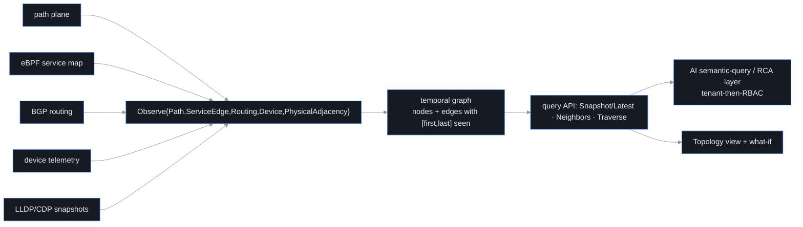

# Topology graph

## What this is

A network has a *shape*: agents reach targets through a chain of router hops,
services call other services, autonomous systems originate prefixes (an
**autonomous system** is one independently-operated network, like an ISP; a
**prefix** is the block of IP addresses it announces to the world), devices
carry interfaces. `internal/topology` is probectl's live model of that shape — a
**tenant-scoped**, **versioned (time-traveling)** graph (a graph is just
nodes — the things — and edges — who touches whom) that stitches together
the signals the other planes already produce:

- **path** discoveries (traceroute) → vantage → hop → hop → host adjacency
  (today the vantage is always the control plane, which the graph records as
  the agent node `agent:control`: path discovery runs on the control-plane
  host, not on agents);
- the **eBPF service map** (eBPF watches connections from inside the kernel) →
  service → service call edges;
- **BGP routing** events → autonomous-system → prefix origin edges;
- **device telemetry** → device nodes (and device → hop links where the
  telemetry exposes interface IPs);
- **LLDP/CDP neighbor snapshots** → direct device/port `physical` edges.

It is the substrate two things sit on top of: the AI semantic-query / root-cause
layer traverses it to explain *why* an incident happened, and the Topology page
in the UI renders it. Because it is one shared graph, a single failure can be
reasoned about across planes — "this hop went down, which broke these paths,
which back these services, which back these SLOs."

## Model

A node and an edge each have a **kind** and a **stable id**, so the same router
or service observed by two different planes folds into one vertex — the id
derives from the identity itself (a passport number, not a visitor badge), so
every sighting lands on the same vertex.

- **Nodes** (`NodeKind`): `agent`, `hop` (a traceroute responder / L3 hop),
  `host` (a path target), `service` (an eBPF workload), `prefix` (a BGP prefix),
  `as` (an autonomous system), `device` (a managed network device). Ids are
  derived from the identity, so they're stable across observations:
  `agent:<id>`, `hop:<ip>`, `host:<ip>`, `service:<workload>`, `prefix:<cidr>`,
  `as:<asn>`, `device:<address>`.
- **Edges** (`EdgeKind`): `path` (hop → hop adjacency), `flow` (service →
  service), `routing` (as → prefix), `device` (device → the hop it carries, via
  an interface IP), `physical` (a directly observed LLDP/CDP local-port →
  remote-port adjacency). An edge's canonical id is `from|kind|to`. Edge attributes
  follow OTel conventions where they exist — a `flow` edge carries
  `destination.port`, `network.transport`, and `network.protocol.name`.

## Cloud inventory

### AWS

A deployment operator can refresh one tenant's AWS account and region. The
command resolves its read credential through the existing secrets integration
and verifies the account with `GetCallerIdentity` before making any inventory
requests. Use `ec2:DescribeVpcs`, `ec2:DescribeSubnets`,
`ec2:DescribeInternetGateways`, `ec2:DescribeNatGateways`,
`ec2:DescribeVpnGateways`, and `ec2:DescribeVpcPeeringConnections`. The command
uses the same AWS credential JSON fields as cloud flow-log imports.

```sh
probectl-control sync-cloud-topology --tenant "$TENANT_ID" \
  --aws-account "$AWS_ACCOUNT" --aws-region "$AWS_REGION" \
  --credential-ref env:AWS_TOPOLOGY_READER
```

The AWS command verifies its configured account before reading EC2 inventory.
Real AWS account verification remains pending. [AWS account identity](https://docs.aws.amazon.com/STS/latest/APIReference/API_GetCallerIdentity.html) · [EC2 VPC inventory](https://docs.aws.amazon.com/AWSEC2/latest/APIReference/API_DescribeVpcs.html)

### Azure

Select an Azure subscription UUID. Provide an OAuth access token for Azure
Resource Manager through a secret reference. In that subscription, grant the
identity `Microsoft.Resources/subscriptions/resources/read` and the
`Microsoft.Network/virtualNetworks/read`, `Microsoft.Network/natGateways/read`
and `Microsoft.Network/virtualNetworkGateways/read` actions.

```sh
probectl-control sync-cloud-topology --tenant "$TENANT_ID" \
  --azure-subscription "$AZURE_SUBSCRIPTION" --credential-ref env:AZURE_TOPOLOGY_READER
```

The command reads VNets, their subnets and peerings, NAT gateways, and up to
128 virtual network gateways per refresh, including VPN and ExpressRoute.
It checks the subscription in resource IDs and follows pagination within
each configured list. Supply a current Resource Manager token for each
refresh. Real Azure subscription verification remains pending. [Virtual networks](https://learn.microsoft.com/en-us/rest/api/virtualnetwork/virtual-networks/list-all?view=rest-virtualnetwork-2025-05-01) · [NAT gateways](https://learn.microsoft.com/en-us/rest/api/virtualnetwork/nat-gateways/list-all?view=rest-virtualnetwork-2025-05-01) · [Virtual network gateways](https://learn.microsoft.com/en-us/rest/api/network-gateway/virtual-network-gateways?view=rest-network-gateway-2025-05-01)

### Google Cloud

Select one Compute Engine project by ID. Provide a read-only OAuth access
token through a secret reference. Use `compute.readonly` scope and the
`compute.networks.list`, `compute.subnetworks.list`, `compute.vpnGateways.list`,
`compute.targetVpnGateways.list`, `compute.routers.list`, and
`compute.routes.list` permissions within that project. Supply a current token
for each scheduled refresh.

```sh
probectl-control sync-cloud-topology --tenant "$TENANT_ID" \
  --gcp-project "$GCP_PROJECT" --credential-ref env:GCP_TOPOLOGY_READER
```

The project-wide view includes VPCs, subnets, HA and Classic VPN gateways,
Cloud NAT configurations, default internet gateway attachments found in
routes, and network peerings. The command rejects incomplete regional results
and responses for a different Compute Engine collection. A failed refresh
leaves the last complete snapshot in place until it expires. Cross-project
peering references stay within the local projection.
Real Google Cloud project verification remains pending. [Networks](https://docs.cloud.google.com/compute/docs/reference/rest/v1/networks/list) · [VPN gateways](https://docs.cloud.google.com/compute/docs/reference/rest/v1/vpnGateways/aggregatedList) · [Routes](https://docs.cloud.google.com/compute/docs/reference/rest/v1/routes/list)

### View and refresh inventory

On the Topology page, open **History & filters** and select **Show cloud
inventory**. Select a cloud node to inspect its source, full resource ID,
prefixes and observation time. Use `GET /v1/topology?include_cloud=true` or
`probectl topology show --query include_cloud=true` for the same projection.
The `topology_cloud` MCP tool returns the cloud portion of the graph. It
requires `ai.query` and tenant MCP egress consent as well as `topology.read`.
A tenant session needs `topology.read`. The projection uses the latest
complete snapshot per source and records the start of the provider inventory
read. An observation must be fresh within one hour of the requested graph
time. `cloud_latest_only`
identifies the latest-snapshot retention policy. Schedule the command through
the deployment's normal job runner to refresh the inventory before it expires.

VPCs with overlapping addresses remain separate. Peering connections show
only their known local attachments and mark a connection with an unobserved
endpoint as external. The cloud relationships describe configured inventory.
What-if calculations continue to use the observed dependency graph. The
effective derived identity retention policy prunes old snapshots even when
live topology collection is off. Cloud inventory deletions are audited under
`cloud_topology_inventories`. Both pooled and siloed inventories are tied to
the tenant directory row, so tenant deletion removes the remaining snapshots.

## Versioning / temporal (designed in, not bolted on)

Every node and edge carries a **validity interval** `[FirstSeen, LastSeen]`.
Re-observing an element extends its interval and merges its attributes, so the
graph remembers *when* each thing existed. It is a ledger of sightings, not a
photo that gets repainted — and replaying the ledger to any moment is exactly
what root-cause
analysis needs (the graph as it was at the incident moment, not as it is now).

- `ForTenant(tenant).SnapshotAt(t)` returns the graph **as it was at time `t`**.
- `ForTenant(tenant).Latest()` returns the full current graph.
- Retention is store-owned: `PROBECTL_DERIVED_IDENTITY_RETENTION_DAYS` prunes
  stale topology nodes and edges from `Latest()`, historical `SnapshotAt`,
  `Neighbors`, and `Traverse`, and records `lifecycle.retention_sweep` receipts
  when labels are deleted. A tighter tenant `flow_retention_days` shortens the
  derived-cache window.



## Query API (the contract everything else consumes)

The `Store` interface (`internal/topology/store.go`) is tenant-bound: callers
first ask for `ForTenant(tenant)` and receive a `TenantStore`. That handle has
no tenant-string arguments, so a later read/write cannot accidentally swap in a
different tenant. Tenant isolation is probectl's outermost boundary (see
[`security/tenant-isolation.md`](security/tenant-isolation.md)); the topology
store enforces it below the API/AI/RBAC layer.

- `SnapshotAt(t)` / `Latest()` — the bound tenant's graph, or its state at `t`.
- `Neighbors(nodeID, t)` — a node's adjacency (the nodes touching it) at `t`.
- `Traverse(from, to, t)` — the shortest directed path between two nodes (the
  traversal RCA — root-cause analysis — walks).
- `Observe{Path,ServiceEdge,Routing,Device,PhysicalAdjacency}(…, at)` — fold one
  plane's telemetry into the bound tenant's graph.
- `IdentityConflicts()` — return the bound tenant's bounded cross-source
  disagreement records. The handle accepts no tenant argument, so a caller
  cannot query a second tenant after binding.

Invalid or empty tenant scopes fail closed. Reading a never-seen tenant returns
an empty snapshot without creating a graph.

For Kubernetes context, select **Show Kubernetes inventory** in Topology
or add `include_kubernetes=true&context_id=<uuid>` to `GET /v1/topology`.
Use `at` for a historical instant or omit it to see the latest completed
observation for each authorized source. Node details report the namespace,
original object UID and observation time. Controller and Service backend edges
show relationships observed in Kubernetes inventory.

`MemoryStore` is the simple in-memory implementation. The `From{Path,
ServiceEdge,BGPEvent}` adapters (`internal/topology/adapters.go`) map the real
signal types into the builder inputs, so a bus consumer can feed the graph
straight from live telemetry. The indexed engine below and any external
graph-database adapter implement this *same* tenant-bound interface — callers
never change.

## All planes feed the live graph

`TopologyConsumer` (`internal/control/topologyapi.go`) folds the streams the
control plane already receives into the graph: eBPF service edges
(`probectl.ebpf.flows`), BGP routing events (`probectl.bgp.events`), and device
telemetry (`probectl.device.metrics`). Path discoveries fold in at save time.
Every batch's claimed tenant is verified against the agent registry; unscoped or
unverifiable records are dropped (guardrail 1).

Bounded LLDP/CDP snapshots arrive separately on
`probectl.device.neighbors`. The consumer verifies the tenant-namespaced lane,
agent registry, and every normalized row, persists the current snapshot before
acknowledging it, then reconciles only the emitting agent + local device's
directly observed `physical` edges in the tenant-bound graph. A successful
empty or partial snapshot removes omitted source-owned edges from the live
graph without touching another source or tenant; historical snapshots retain
the earlier observation. An incomplete poll emits no replacement snapshot, so
previous evidence remains visible until it ages stale rather than disappearing
as a false empty. Missing neighbor evidence leaves the live edge absent.

Device → hop linkage depends on the telemetry exposing interface IPs. When it
does (`ObserveDevice` with `InterfaceIPs`), the device node links to the hops it
carries: SNMP collection reads them from `ipAddrTable`, so a polled device links
to a `hop:<ip>` for each IPv4 address it holds (loopback included). When it does
not — which is the case for gNMI device telemetry today — the device node still
exists, but **without** links, and that gap is **reported** as a coverage note
(below), never silently treated as "complete."

A neighbor known only from LLDP/CDP leaves the live graph together with its
last adjacency: when a device stops reporting it (the uplink moved to another
switch), `Latest()` drops both the edge and the neighbor's node, while
`SnapshotAt` still shows them at the times they were observed. A node with any
other evidence (a managed device, the local end of another snapshot) stays.

Before a device observation updates the graph's visible label, the graph also
retains its normalized source claim. Distinct management-address, device-name,
interface-address, interface-name, or interface-index values become stable
read-only conflict records instead of disappearing behind last-writer-wins.
These records are a replayable derived view, not a new system of record: bus
replay rebuilds them after restart, the per-tenant graph caps their memory, the
derived-identity retention sweep prunes their evidence, and tenant erasure
drops them with the graph. They never pick a winner or mutate topology.

## What-if / impact simulation

`Simulate` answers: *"if node or link X fails, what breaks?"* — a fire drill
run on the floor plan, never the building. It runs on a
snapshot of the versioned graph (a zero time = the live graph), removes the
failed element, and recomputes reachability. Fail any node (`hop:…`, `service:…`,
`as:…`, `prefix:…`, `device:…`, `agent:…`) or any edge (`from|kind|to`) and you
get:

- **broken** agent→target paths — routes with no surviving alternative;
- **rerouted** paths — with the surviving route returned alongside the original;
- **impacted services** — the transitive callers of a failed service/host:
  walk the call arrows *backward* and collect everyone that depends on it,
  directly or through intermediaries
  (reverse reachability over `flow` edges);
- **impacted prefixes** — prefixes a failed AS originated (a failed prefix is its
  own impact);
- **disconnected** nodes — reachable from some agent before, from none after;
- **SLO impact** — via the `SLOSource` seam (when the SLO engine is wired;
  absent = an explicit coverage note, never a silent empty).

Three honesty rules matter. First, an **unknown target is an error**, never an
empty "no impact" — a typo in a simulation must not look like a clean result.
Second, simulation accuracy depends on graph completeness, so every result
carries a **coverage block** — per-plane edge counts, including physical edges,
plus notes for missing
planes ("no flow-plane (eBPF) edges — service impact may be incomplete"). Read
it like the station count printed on a weather forecast: trust the prediction
in proportion to how many stations reported. The
simulation is strictly **read-only**: it runs on a copy and never mutates the
graph. Acting on a prediction is a separate, human-gated capability (see
[`remediation.md`](remediation.md)) — probectl predicts, a human decides.
Third, a name or management address alone never creates a physical edge:
LLDP/CDP port evidence is required.

## Visualization

`ToViz(snapshot)` projects a snapshot to a layout-agnostic `Viz` shape — just
nodes (`id`, `kind`, `label`) and edges (`from`, `to`, `kind`, `label`). The UI
computes positions client-side, so the server stays layout-agnostic.

## Engine: in-memory vs indexed

`IndexedStore` implements the same `Store` contract as `MemoryStore`, but backs
it with forward/reverse adjacency indexes, so `Neighbors` and `Traverse` are
proportional to a node's degree (how many edges touch it) instead of the whole
edge set — the behavior
large graphs need. The engine is selected by `PROBECTL_TOPOLOGY_ENGINE`
(`indexed`, the default | `memory`); the switch is transparent behind the query
API. A scale test exercises both correctness and interactivity at roughly 30k
nodes. An external graph-database adapter can implement the same interface when
a deployment outgrows a single process.

## API + surface

- `GET /v1/topology[?at=RFC3339]` — the caller's tenant graph (live, or as it was
  at `?at=`), in the layout-agnostic node/edge shape plus the coverage block.
  Permission: `topology.read`. (When topology isn't wired on a deployment, the
  endpoint returns `topology_running: false` with empty node/edge lists.)
- `GET /v1/topology?context_id=<routing-context-uuid>` adds a **current** FX-2
  canonical annotation to valid device/hop/host address nodes. Stable graph IDs
  and historical `?at` snapshots remain unchanged. Each checked node says
  `resolved`, `conflict` or `unresolved`; only a unique match has a canonical
  entity ID. The response gives the lookup time and marks truncation after
  640 distinct addresses, so an unchecked tail is never mistaken for
  unresolved identity. This opt-in read also requires `entities.read` and every
  returned source plane's read permission; a denied source refuses the full
  projection. The Topology page has an explicit routing-context selector.
  The entity registry also retains evidence-backed LLDP/CDP physical links
  for audit. Those rows are observed history, not an extra live graph feed;
  the current topology continues to use its bounded neighbor snapshots. A
  neighbor evidence row's `current` flag confirms its local source mapping and
  SVID, not that the remote cable still exists or resolves uniquely now.
- `POST /v1/topology/whatif {target, at?}` — the simulated impact for failing one
  node or edge. Permission: `topology.read`. The response names affected path
  tests by their observed agent and target, reports broken/rerouted routes,
  services, prefixes, disconnected nodes, known SLO impact, explicit coverage
  gaps, and a coverage-derived confidence score. That score says how many
  evidence seams are wired; it is not a probability. An unknown target is a
  `404`.
- `GET /v1/topology/whatif/export?target=...&at=...` — reruns the same
  tenant-scoped, read-only calculation and downloads its JSON result. The route
  is RBAC-gated and recorded as an export in the tenant audit trail.
- The **Topology** page renders the layered graph (columns by kind, capped for
  legibility on dense graphs with an honest "showing N of M"), node drill-down,
  one version clock, and an explicit added/removed/changed node-and-edge diff.
  The version-clock input uses UTC, independently of the browser timezone.
  Scrubbing the clock preserves the selected entity. Incident evidence can pivot
  into the selected entity and open the what-if overlay in two interactions
  while preserving the incident, evidence, time range, filters, and return path.
  The overlay is labeled **observe-only dry-run** and shows affected tests,
  services, the authorized linked incident, routes, known SLOs, confidence, and
  gaps before offering the audited JSON export.
- `GET /v1/device/identity-conflicts` — bounded conflict/provenance rows and
  exact affected-correlation pivots. Permission: `topology.read`; every
  successful read is tenant-audited. The same review-only card is present in
  the Topology and Device workflows. `topology_running:false`, truncation, and
  clean/filtered-empty states are distinct.
- `GET /v1/device/neighbors` — bounded current/stale LLDP/CDP rows with direct
  device/port provenance, freshness, and confidence. Permission:
  `topology.read`; reads are tenant-audited. The same data appears in
  **Planes → Device** and `probectl device neighbors`.
- `GET /v1/device/collection-outcomes` — bounded current receipt per configured
  target/protocol, distinguishing rows, successful empty, unsupported, failed,
  and never observed. Permission: `topology.read`; reads are tenant-audited.
  The receipt is stored independently, so a failed attempt never clears
  last-known-good physical edges. The same contract appears in Device, Admin,
  generated SDKs, and `probectl device outcomes`.

## Traffic-aware failure preview

Select a physical link or a device in **Topology → Traffic what-if**. Choose its
owned routing context and an ended observation window. The simulation compares
the offered load before and after the hypothetical failure for each direction
of each observed interface. It uses original flow intervals and sampling,
verified SNMP counter intervals and link speeds, and currently witnessed BGP
routes. Parallel physical links require the exact failed interface. The query
requires `topology.read`, `flow.read`, `entities.read`, `metrics.read`, and
`events.read` in the selected context.

For a reroute projection, enable the router's BMP post-policy inbound unicast
view alongside its selected Loc-RIB. The collector needs complete current
observations for the global peers in that router's owned base context. A router
whose current binding or neighbor observations do not identify those views
reports the affected traffic as unresolved.

The POST `/v1/topology/whatif` accepts `target`, `context_id`, `traffic_from`,
`traffic_to`, and `maximum_poll_gap`. Use RFC 3339 timestamps and a positive
duration such as `90s` for the gap. The optional `failure_interface_id` selects
a parallel link. The optional `runout_until` sets a future forecast horizon.
Use the live graph for a traffic projection. For a historical `at`, the graph
remains available and the traffic result reports missing historical route
eligibility. A target-only request keeps the graph simulation.

Save the same JSON request to `simulation.json` for the CLI. The Topology panel
offers an audited JSON download using the GET `/v1/topology/whatif/export`
with those fields as query parameters. Both generated SDKs expose the export
parameters and the traffic response schema.

```sh
probectl topology whatif --body-file simulation.json
```

Rerouted, unrouted, and unresolved bytes are exact estimates from the retained
flow population. The model applies route transfers to concurrent directional
counter measurements before calculating the peak. Covered flow rates must be
within five percent of the independent egress counter rate on a failed link
to support a complete projection. Rates and utilization are
exact decimal integers or fractions. Offered load can exceed the link speed.
Missing, conflicting, or unverified observations can leave a load or peak
unavailable. Runout also needs stable capacity and two complete weeks of
five-minute projected samples. The calculation is read-only.

## Real-stack receipt

`TestTopologyGraphRealStack` (`internal/topology/realstack_integration_test.go`,
the F40 receipt in CI's integration lane) builds two tenants' graphs on the
shipped control plane from real inputs that all sit on 127.0.0.1, so a lost
tenant scope shows: each tenant's shipped device agent polls its own net-snmp
device (device node, `device` edges to its loopback and eth0 hops, a `physical`
LLDP edge to its neighbor), each traces 127.0.0.1 from the control plane
(`agent:control → hop → host`), and each tenant's shipped BGP analyzer sidecar
publishes its own origin event (`as → prefix`). It requires each graph to be
exactly the tenant's nodes and directed edges on `GET /v1/topology`,
`probectl topology show` and the rendered Topology page; what-if on the shared
hop and on the origin AS to list only the tenant's own downstream nodes and
path test (the other tenant's elements are a 404); the BGP incident's prefix
and origin to be nodes of the tenant's graph, and RCA to walk from the address
to the tenant's device, neighbor and originating AS; and a moved LLDP neighbor
to update the live graph while `?at=` keeps the earlier adjacency. eBPF service
edges are not an input of this receipt (ING-24: inbound flow direction is
reversed); NetFlow/IPFIX records are not a topology input.

## Out of scope (by design)

Acting on what-if predictions or preventing the simulated failure (those are
separate, human-gated remediation capabilities); dependency mapping beyond the signals the planes actually emit
(probectl links what it observes, and reports the gaps where it can't). The
AI/RBAC-aware query layer sits *on top of* this graph, enforcing tenant first,
then RBAC — the topology store itself is the tenant-scoped foundation.
